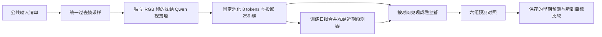

# Idea 01 接入 EgoLife bench_v0：延迟残差预测记忆

本轮以 `ideax_output/idea_01/idea_card.md` 为实现依据。目标是检验历史中已经发生的
cue→outcome 关系能否改善后续预测。目前实现安全数据接口、冻结视觉特征和在线
latent 预测预检。动作选择题读出、slow 参数的 outer training、完整 Spatial 集成
及与 VLM ICL 的准确率比较属于后续阶段。

补充：原始 Qwen 与官方 Spatial checkpoint 的全 200 题 MCQ 基线已另建独立
评测入口，见 [bench_v0 选择题基线](BENCH_V0_MCQ_BASELINES.md)。该实验不代表
Idea 01 已具备动作读出，也不改变本文 latent 预检的结论。

## 数据与划分

数据目录 `/data/share/raw/bench_v0` 的本机审计结果：

| 项目 | 实际状态 |
|---|---|
| 样本 | 200 条，6 位佩戴者、7 天、42 个 person-day |
| 每例输入 | 1800 秒 context + 30 秒 recent |
| 目标 | cutoff 后 5 秒内的一个具体动作，六选一 |
| 视频 | context 为 512×512、2 FPS；recent/future 为 704×704、20 FPS |
| 标签 | silver labels；193 supported、7 unclear，0 条人工核验 |
| 原始划分 | 全部为 benchmark，无官方训练集 |
| 重叠 | 97 对同人同日样本中，一条的 future 出现在另一条的 past |
| 同日时间窗 | 所有佩戴者合计 440 对重叠，32 个连通簇，包含同人重叠 |

这批数据适合在长前缀内累计成熟写入，但不保证目标动作有重复线索。不同佩戴者可能
同时处于同一场景，因此不能随机按行划分，也不能仅按佩戴者划分。本轮生成**非官方
研究划分**：第 1–4 天训练（111）、第 5 天验证（32）、第 6–7 天测试（57），同日
所有佩戴者整体隔离。此划分上的结果不能称为原始 200 条完整 benchmark 零样本结果。

推理入口只读 `inputs_mcq.jsonl`，允许本例的 `context.mp4`、`input.mp4`、问题和
选项文本。`metadata.jsonl` 只由独立审计/分组入口读取。future、答案、干扰项角色和
未来观察文本均不进入本轮特征或在线写入。

## Idea 01 的更新方式

已到达特征为 `z_t`，冻结近期预测器为 `b(t,h)`，fast memory 为
`f_W(k)=B SiLU(Ak)`：

```text
时刻 t：
  prediction(t,h) = b(t,h) + f_Wh(k_t)
  保存当时的 prediction，用于将来评分
  FIFO 保存 (t+h, k_t, stopgrad(b(t,h)))

真实帧 z_(t+h) 到达：
  先对过去保存的 prediction(t,h) 评分
  residual_target = z_(t+h) - b(t,h)
  对 ||f_Wh(k_t) - residual_target||² 做一次更新

视频截止：
  停止写入，只读当前 W 产生未成熟的未来预测
```

例如，前面已看见多次“打开某柜门后取杯子”，新出现相似线索时，记忆可能补充通用
近期预测器未掌握的本段视频规律。首次出现或随机动作仍可能无法预测。残差只是待
检验的写入目标，不能预设它一定比直接写未来特征更好。

默认四个 horizon 是 1/2/4/10 个步，即 2 FPS 下的 0.5/1/2/5 秒。四组
`256→128→256` MLP 有 262,144 个 FP32 fast values，共 1 MiB；FIFO、近期缓存和
bank 另报字节。每例独立 reset，没有 optimizer momentum。

## 实现架构



| 文件 | 职责 |
|---|---|
| `ttt_frame/forecast_bench.py` | 公共输入白名单、时间网格、独立审计、按天划分 |
| `ttt_frame/forecast_features.py` | 因果采样、独立 image 编码、固定池化与投影 |
| `ttt_frame/predictive_memory.py` | 可微分的延迟残差 MLP 算子 |
| `ttt_frame/forecast_residual.py` | 近期 predictor、在线更新和成熟评分 |
| `scripts/run_forecast_residual.py` | 校验 split/cache，拟合 train-only baseline，输出结果 |

使用 Qwen3-VL-2B 的冻结视觉塔独立编码图像。批处理的帧之间不共享 attention；
image temporal patch 仅复制当前图像，不读取未来帧。空间池化为 2×4 tokens，固定
随机正交投影到 256 维，再作无参数 LayerNorm，投影不在 benchmark 上拟合。

第一版尚无 learned key projector 或经过 outer training 的 fast initialization。
近期预测器使用训练集统计量，以当前特征及过去短窗口均值作 ridge regression，
拟合完成后冻结。训练样本之间不配对 cue 与 target。

| 对照 | 预测方式 | 检验目的 |
|---|---|---|
| `persistence` | 延续当前特征 | 画面平稳是否已经足够？ |
| `recent_only` | 冻结近期预测器 | 通用近期信息能解释多少？ |
| `plain_delayed` | 成熟时直接写 future latent | 残差是否优于普通延迟监督？ |
| `residual` | 近期预测 + residual memory | 已发生的误差关联是否有帮助？ |
| `reset_residual` | 每步复位权重，保留成熟 FIFO | 长期 fast state 是否必要？ |
| `explicit_bank` | 有界保存成熟 cue/residual，近邻读取 | 简单保存证据是否足够？ |

显式 bank 是特征检索对照，**不等于 VLM ICL**。六组也不是完整论文的同监督
outer-trained 模型。plain_delayed 从零输出学习完整 latent，而 residual 冷启动
已有近期预测，因此初期差异不能单独解释为记忆架构优势。

runner 默认 `--bank-capacity 16`，每个 horizon 存 16 组 cue/residual，四组共
1 MiB，与默认 fast MLP 的权重字节相同。它们的运算量和实际检索能力仍不同。
当前 runner 在 CPU 上预加载特征缓存并按因果顺序访问；缓存、冻结预测器和用于
评分的临时队列都不计入上述 1 MiB，结果中另列缓存/预测器/近期窗口/FIFO 字节。

## 时间与指标

全输入按 2 FPS 取 context 3600 帧、recent 60 帧。最后请求时刻为 1829.5 秒，
cutoff 为 1830 秒。解码选择不晚于请求的 PTS，保存实际 PTS 和请求时刻。

最后预测的四个 target 相对 cutoff 是 **0、0.5、1.5、4.5 秒**。JSON 显式记录
这些时刻。当前预检只评分截止前已成熟的预测，默认统计最后 30 秒内发出的预测；
最后的未成熟预测另存，future 视频不参与更新或本轮评分。

MSE 在仅由训练视频确定的标准化空间计算，每个 origin/horizon 先对 8×256 元素
取均值；count 是已成熟预测对数，不是独立样本数。正式统计应按录制日/源事件聚类。
MCQ 目标是 5 秒内的动作，单点 latent MSE 易被背景主导，不能代替动作准确率。

## 运行命令

```bash
cd /home/quzitsix/TTT_frame
conda run --no-capture-output -n meowbench python scripts/prepare_forecast_bench.py \
  --root /data/share/raw/bench_v0 \
  --output-dir runs/forecast_bench_v0 --make-research-split
```

以下先取训练日 1 的 `egolife_001`、验证日 5 的 `egolife_019` 验证流程。按当前资源
选择 device；程序只加载视觉塔。

```bash
conda run --no-capture-output -n meowbench python scripts/cache_forecast_features.py \
  --root /data/share/raw/bench_v0 --ids egolife_001 egolife_019 \
  --model-path /data/quzitsix/models/Qwen3-VL-2B-Instruct \
  --device cuda:2 --dtype bfloat16 --batch-size 4 --max-side 224 \
  --sample-fps 2 --output-dir runs/forecast_bench_v0/features_224

conda run --no-capture-output -n meowbench python scripts/run_forecast_residual.py \
  --cache-dir runs/forecast_bench_v0/features_224 \
  --split-manifest runs/forecast_bench_v0/research_day_split.json \
  --train-ids egolife_001 --eval-ids egolife_019 --eval-role validation \
  --output-dir runs/forecast_bench_v0/idea01_pilot \
  --threads 4 --score-last-seconds 30
```

`--context-tail-seconds` 或 `--limit-frames` 会产生明确标记的截短 smoke 缓存，runner
默认拒绝，需 `--allow-partial-prefix` 才能读取。截短结果不能声称测试了 30 分钟
记忆。完整研究划分需要缓存 split 中全部 ID，随后去掉 runner 的两个 ID 子集参数。

## 怎样检验 TTT 是否优于 ICL

下一阶段训练一个共同动作 readout：融合 recent 证据、多 horizon 预测和候选动作
文本，对六个候选对称打分。只用训练日答案训练、验证日选参数、测试日固定。
200 个不同动作句子不能直接作为 200 类分类器；随机 256 维视觉 latent 也不能直接
与 Qwen 文本 hidden 做余弦相似度当答案，必须训练对齐/readout。

正式比较分两组：

1. **相同证据**：ICL 和 TTT 使用相同帧、分辨率、近期窗口、问题与选项；比较
   blind、recent-only、ICL、TTT、reset 和错 episode memory。
2. **相同预算**：约束实际显存、编码次数和读取计算，报告精度/成本曲线。TTT 处理
   更多历史时，结论是该预算下的系统收益。

支持 Idea 01 需要 residual 优于 plain delayed/近期预测，收益在 reset 或错历史
时消失，并在重复 cue 子集及最终动作任务上复现。若 explicit bank、强 ICL 或
同监督递归模型已达到同等效果，应接受在线参数更新没有额外收益。

## 验证

本轮新增协议、采样、视觉塔、成熟评分和 CLI 集成测试。仓库完整测试为
`240 passed`，重点覆盖后缀帧扰动不改变早期预测、独立图像之间无 attention
混入、整数时间网格和未来 PTS 拒绝、训练统计量冻结，以及 episode state reset。

```bash
conda run --no-capture-output -n meowbench python -m pytest -q
```

## 本轮真实视频试跑范围

完整模式在本机计时发现编码约需 1.1 秒/帧：空闲 GPU 上 batch=4 的热运行约
4.43 秒，batch=16/32 分别约 17.87/37.70 秒。按此实测吞吐，两个完整 3660 帧
样本串行编码预计需要两个多小时。本轮停止了尚未产生缓存的完整试跑，改用每例 context 最后
60 秒 + 完整 recent 30 秒，共 90 秒、180 帧验证流程。

实际缓存目录为 `runs/forecast_bench_v0/features_224_tail60`，训练样本
`egolife_001`、验证样本 `egolife_019` 来自不同录制日。两者均使用 224 最大边长、
2 FPS，均标记 `cropped=true`、`complete_prefix=false`。该 smoke 不能验证
30 分钟长期记忆或完整动作 forecasting 性能。

```bash
conda run --no-capture-output -n meowbench python scripts/cache_forecast_features.py \
  --root /data/share/raw/bench_v0 --ids egolife_001 egolife_019 \
  --model-path /data/quzitsix/models/Qwen3-VL-2B-Instruct \
  --device cuda:2 --dtype bfloat16 --batch-size 4 --max-side 224 \
  --sample-fps 2 --context-tail-seconds 60 \
  --output-dir runs/forecast_bench_v0/features_224_tail60

conda run --no-capture-output -n meowbench python scripts/run_forecast_residual.py \
  --cache-dir runs/forecast_bench_v0/features_224_tail60 \
  --split-manifest runs/forecast_bench_v0/research_day_split.json \
  --train-ids egolife_001 --eval-ids egolife_019 --eval-role validation \
  --allow-partial-prefix --output-dir runs/forecast_bench_v0/idea01_tail60_pilot \
  --threads 4 --score-last-seconds 30
```

已有缓存不会被覆盖；复用现有缓存时只执行第二条命令，并选择新的 output-dir。

### 实测结果

产物：`runs/forecast_bench_v0/idea01_tail60_pilot/summary.json`、
`recent_predictor.pt`、`egolife_019_forecasts.pt`。训练日只使用一个样本的过去视频
拟合 baseline，验证日也只有一个样本；没有 outer training，没有调参选优。

下表是训练统计量标准化后的视觉 latent MSE，越低越好。每组共有 **223 个成熟
origin/horizon 预测对，来自同一个验证视频**，不能当作 223 个独立测试样本。

| 方法 | 综合 MSE | 0.5s | 1s | 2s | 5s |
|---|---:|---:|---:|---:|---:|
| persistence | 1.1677 | **0.8981** | 1.1049 | 1.2687 | 1.4456 |
| recent-only | 1.7238 | 1.5415 | 1.7157 | 1.8085 | 1.8535 |
| plain delayed | **0.9877** | 0.9336 | **0.9754** | **1.0041** | **1.0476** |
| residual | 1.5240 | 1.3133 | 1.4741 | 1.6262 | 1.7159 |
| reset residual | 1.7181 | 1.5331 | 1.7090 | 1.8041 | 1.8506 |
| explicit bank | 2.0802 | 1.4796 | 1.9278 | 2.2892 | 2.7316 |

四个 horizon 的可评分预测数依次为 59/58/56/50。fast 方法和 bank 都兑现了 703 次
成熟更新，持久 episode state 均为 1,048,576 bytes，结束时 FIFO 各为 278,528 bytes。
recent predictor 拟合约 0.09 秒，CPU 四线程运行六组对照约 4.31 秒；两份视觉缓存
分别耗时约 310.18/281.74 秒（不含视觉塔启动）。

当前可支持的结论有限且具体：

- residual 相对 recent-only 的 MSE 降低 11.6%；reset 后几乎回到 recent-only。
  在这条轨迹上，历史累计更新比仅兑现当前到达的更新更有用。
- plain delayed 比 residual 更好，综合 MSE 也比 persistence 低约 15.4%，但在
  最短 0.5 秒 horizon 仍稍弱于 persistence。**本次不支持残差目标的独立优势。**
- recent-only 比 persistence 差，表明仅一个训练窗口拟合的通用预测器尚弱。
  残差模型可能在补偿 baseline 的偏差；它不等于已学到有意义的动作规律。
- 不同动作的可区分性、错历史控制、重复 cue 子集、完整 30 分钟输入、多个独立
  episode 和最终 MCQ/ICL 对比均尚未验证。

下一阶段应先在训练日扩充近期预测器训练，并在验证日比较 persistence 与近期
预测器；随后再学习 key projector/fast initialization，保留 plain delayed 强对照。
若改进近期预测器后 residual 仍不优，就优先推进更简单的延迟写入路线。
