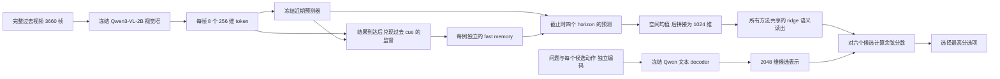

# Idea 01：完整视频前缀上的 forecasting 选择题评测

本轮把 Idea 01 的延迟残差记忆接到一个共享的动作选择题读出上，处理 bench_v0 的全部
200 段输入视频。主评测使用此前冻结的 57 道测试题；111 道训练题和 32 道验证题分别用于
拟合读出和选择正则强度，不能把 200 题总准确率当作零样本或独立测试结果。

这是一版**冻结视觉编码器 + 独立小型 fast memory + 监督语义读出**的机制原型。
它没有修改 Qwen 的语言层，也没有加载官方 Spatial-TTT slow weights；尚未实现提案中的
learned key、slow initialization outer training 或多层 Spatial 集成。因此，结果回答的是
“当前最小延迟残差记忆能否帮助动作预测”，不能代表整个 Idea 01 提案已经完成。

后续已完成 1×/4×/16× fast 容量、离线初始化训练和在线更新量的 12 组扩展，见
[容量与训练量实验](IDEA01_SCALING_RESULTS.md)。视觉 MSE 改善，主比较的 residual
动作准确率仍为 24/57；本页保留最初实验的原始配置和结果。

## 证据与训练边界

- 数据：`/data/share/raw/bench_v0`，200 道六选一、cutoff 后 5 秒动作预测。
- 每例输入：1800 秒 context + 30 秒 recent，以 2 FPS 编码完整 **3660 帧**，最大边长 224。
- split：按录制日及当天全部参与者分组；第 1–4 天 train 111、第 5 天 validation 32、
  第 6–7 天 test 57。使用与原始 VLM baseline 相同的固定 test IDs。
- 视觉缓存及在线记忆只读公共输入和过去视频，不读 `future.mp4`、caption、答案或私有元数据。
- 近期预测器、视觉与文本标准化统计只用 train；答案监督仅在共享语义读出阶段使用。
- 读出调参只访问 train/validation 的答案字段；先写完全部预测，再独立调用 scorer 读取 test 答案。
- 每个 episode 重建 fast weights、FIFO 和 bank；不同题目之间不传递在线记忆。
- 标注仍是自动筛选的 silver labels。测试仅有两个录制日，且同日题目可能重叠，不能按
  57 个独立样本宣称显著性。

原始数据与泄漏审计见 [Idea 01 接入说明](IDEA01_BENCH_V0.md)，历史九组 VLM 结果见
[完整基线报告](BENCH_V0_MCQ_BASELINES.md)。

## 从过去视频到答案



视觉塔将每张图像独立编码，图像之间不共享 attention；2×4 空间池化、固定正交随机投影
和无参数 LayerNorm 产生 `8×256` 特征。视觉卷积使用显式 linear patch 路径，并替换为
逐图 SDPA，缓存协议记录执行路径、批大小、模型内容和源码哈希。浮点路径与旧慢实现
并非逐位相同，比较时使用同一份缓存。

近期预测器以当前 token 和过去四步均值为输入，为四个 horizon 分别拟合 ridge regression。
它在训练集拟合一次后冻结。四个 horizon 为 1、2、4、10 步，即 0.5、1、2、5 秒；最后
观测位于 1829.5 秒，所以最后四个预测相对于 1830 秒 cutoff 的目标时间是
**0、0.5、1.5、4.5 秒**。这些是目标窗口内的视觉状态预测，尚不是动作区间检测。

fast memory 是四组 `256→128→256` 的无偏置 MLP：

```text
prediction(t,h) = b(t,h) + B_h SiLU(A_h k_t)
z_(t+h) 实际到达后：
    target = z_(t+h) - stopgrad(b(t,h))
    用过去保存的 k_t 对 MSE 做一次学习率 0.05 的更新
```

`A` 使用固定 seed 0 随机初始化，`B` 从零开始，key 使用标准化视觉 token。
四组共 **262,144 个 FP32 fast values = 1 MiB**，没有 optimizer momentum。
逻辑 FIFO、显式 bank、冻结预测器以及输入特征缓存的内存另报，不能把它们算作免费状态。

共享读出把四个 horizon 的空间均值拼成 1024 维，映射到冻结 Qwen 文本 decoder 产生的
2048 维候选表示。每个候选单独编码“问题 + 候选动作”，不含 A–F 标签或选项位置。
训练候选的均值/标准差用于固定文本变换，再 L2 normalize；视觉统计同样只用 train。

每道训练题提供七个方法视图，全部拟合同一组 ridge 系数，不输入方法名称。111 道题
产生 777 行回归数据，**独立题目数仍是 111**。正则目标为平均平方误差加
`lambda × ||W||²`；验证集在 `[0.01, 0.1, 1, 10, 100]` 中选择七组总正确数最高者，
并列时取更大的 lambda。选定后不使用 validation 重拟合，也不根据 test 结果改变配置。

| 参数块 | 规模 | 什么时候变化 |
|---|---:|---|
| Qwen 视觉塔 | 406,957,056 个参数值 | 全程冻结 |
| Qwen 文本 decoder（不加载 lm_head） | 1,720,574,976 个参数值 | 全程冻结 |
| 视觉投影与空间池化 | 输出每帧 `8×256` | 固定随机投影，无训练 |
| 近期 ridge predictor | `4×513×256 = 525,312` 个系数，另有均值/标准差 | 只在 train 拟合一次 |
| fast MLP | 四组，共 262,144 个 FP32 值 | 每例从相同初始值开始，过去结果成熟后更新 |
| 共享语义 ridge readout | `1024×2048 = 2,097,152` 个系数，另有统计量 | train 拟合，validation 选择正则；test 冻结 |

语义读出在 CPU 以 FP64 求解/推理；它的系数约 16 MiB。它不属于随视频写入的 1 MiB
fast memory。最终答案不会把原视频或完整 caption 再次送入语言模型，而是从截止时的
四组预测特征与候选文本表示计算分数。这里的“记忆参与回答”发生在视觉预测特征这一步。

## 对照方法

| 方法 | 截止时如何预测 | 用途 |
|---|---|---|
| persistence | 四个 horizon 均延续最后一帧特征 | 检查当前外观本身能解释多少 |
| recent_only | 冻结近期预测器 | 禁用所有在线参数更新的主要对照 |
| plain_delayed | 成熟时直接写未来特征 | 检查 residual 是否优于普通延迟监督 |
| residual | 近期预测 + 累计残差 fast memory | 本轮 Idea 01 最小实现 |
| reset_residual | 每次成熟更新前复位 fast weights，保留延迟 cue | 检查持续累积状态的价值 |
| nearest_bank | 每个 horizon 保存最近 16 组成熟 cue/residual，近邻读取 | 与约 1 MiB 显式特征记忆比较 |
| recent_tail_residual | 进入最后 30 秒时清空权重、FIFO 和近期窗口 | 检查更早 1800 秒的额外价值 |
| text_prior | 训练集正确候选表示的均值与各选项打分 | 检查语义/选项先验，完全不输入视觉 |

前七组的文本读出完全相同；`nearest_bank` 是视觉特征检索，不等同于 VLM ICL。
`plain_delayed` 从零学习完整 latent，`residual` 冷启动已有近期预测器，因此二者不仅
存在目标差异，也存在初始化预测差异。

历史 ICL/Spatial 基线每题使用 90 帧，本轮使用 3660 帧，并额外训练动作语义读出。
历史基线能提供相同测试题上的参考值，不能用单个准确率宣称等帧、等训练量或等预算胜出。

## 结果与复现

已完成 200 段完整前缀的视觉编码和七组在线记忆，并冻结 **1600/1600** 条有效选择题
预测；无缺失、解析失败或运行错误。共享读出的 validation 总正确数随 lambda
`0.01/0.1/1/10/100` 分别为 `76/85/78/82/93`（每项分母为七组共 224 条预测），
故依照预先固定规则选择 **lambda=100**。这是网格边界，不能声称正则已全局最优。

| 方法 | Train 111 | Validation 32 | **Test 57** |
|---|---:|---:|---:|
| persistence | 99（89.19%） | 14（43.75%） | **24（42.11%）** |
| recent_only | 97（87.39%） | 14（43.75%） | **24（42.11%）** |
| plain_delayed | 94（84.68%） | 10（31.25%） | **25（43.86%）** |
| residual | 98（88.29%） | 14（43.75%） | **24（42.11%）** |
| reset_residual | 97（87.39%） | 14（43.75%） | **24（42.11%）** |
| nearest_bank | 103（92.79%） | 13（40.62%） | **23（40.35%）** |
| recent_tail_residual | 97（87.39%） | 14（43.75%） | **24（42.11%）** |
| text_prior | 59（53.15%） | 11（34.38%） | **16（28.07%）** |

同一固定测试集上的历史参考：

| 历史方法 | Test 正确 / 57 | 准确率 |
|---|---:|---:|
| 原始 Qwen blind | 9 | 15.79% |
| 原始 Qwen recent-ICL | 23 | 40.35% |
| 原始 Qwen full-ICL | 21 | 36.84% |
| 官方 Spatial checkpoint blind | 11 | 19.30% |
| 官方 Spatial checkpoint recent-ICL | 11 | 19.30% |
| 官方 Spatial checkpoint full-ICL | 10 | 17.54% |
| Spatial fast + slow | 12 | 21.05% |
| Spatial slow-only | 13 | 22.81% |
| Spatial 原始 base 参数对照 | 11 | 19.30% |

本轮 residual 比原始 Qwen recent-ICL 多对 1 题，但其输入帧数和训练监督不同，
而且它与完全关闭在线更新的 recent_only 结果相同，因此**没有证据表明增益来自 TTT**。

### 答案一致是否因为记忆没有更新？

不是只比较准确率：测试集 residual 与 recent_only 的 **57 个选择答案全部一致**。
reset_residual 也全部一致。它们的候选分数并不相同：residual 相对 recent_only 的
逐题最大分数差，均值为 **0.01474**，最大 **0.03614**；reset 的对应均值为
0.000249。记忆影响了连续表示和分数，但在这组题和当前读出下没有改变 argmax。
八组在测试集都没有并列最高分。

测试视频中的 residual fast-weight 变化范数均值约 **3.05**，相对近期预测的最终视觉
latent RMS 差均值约 **0.0583**。这进一步确认更新与读取均实际发生。验证集选择的
强正则可能削弱不同方法的分数差异，但当前证据不足以把失败唯一归因于读出。
每个完整测试 episode 兑现 **14,623** 次成熟写入，残差 fast-weight 范数变化范围为
2.69–3.68。对 `egolife_001` 重放七组方法与已保存预测逐位一致；将学习率设为零后，
residual 与 recent_only 的输出最大绝对差为 **0**。

| 相对 recent_only 的测试对照 | 答案改变题数 | 由错变对 | 由对变错 |
|---|---:|---:|---:|
| persistence | 1 | 0 | 0 |
| plain_delayed | 6 | 1 | 0 |
| residual | 0 | 0 | 0 |
| reset_residual | 0 | 0 | 0 |
| nearest_bank | 2 | 0 | 1 |
| recent_tail_residual | 1 | 0 | 0 |
| text_prior | 17 | 0 | 8 |

plain_delayed 的 +1 题来自第 7 天；第 6 天 recent_only/residual/plain 都是 9/31，
第 7 天分别是 15/26、15/26、16/26。只用最后 30 秒的 residual 与全前缀 residual
得分相同，当前结果没有建立更早 1800 秒历史的回答收益。

text_prior 达到 28.07%，说明学习到的动作文本先验本身已有一定预测能力。
视觉方法高于这个对照，但 train 与 test 的明显差距（如 residual 88.29%→42.11%）
也表明小样本监督读出的泛化仍是瓶颈之一。候选独立编码消除了字母作为特征的路径，
并不能消除候选文本难度、语义合理性或数据分布带来的先验。

### 能得出的结论

1. **当前最小 residual 原型没有表现出优于无更新、reset 或仅近期记忆的动作准确率。**
   用户担心“训练与不训练效果相近”，在这一版本上得到了直接的消融支持。
2. 普通延迟写入多对 1 题；不足以支持稳定优势，更不足以支持 residual 目标的独立价值。
3. 结果不能区分“记忆没有学到动作规律”和“空间均值、随机视觉投影及线性读出丢失了
   有用变化”。当前设计也没有 outer task loss 去教 fast memory 保存对候选动作有用的内容。
4. 下一轮应先在训练/验证日审计自然重复 cue→outcome 事件，并对同监督、同帧输入的
   no-update、plain delayed、residual 和递归模型比较，再决定是否增加 learned key 与
   outer training。先保留本轮 test 结果；不能反复依据这 57 题调参后继续称为独立测试。

### 运行与产物

视觉编码共处理 **732,000 帧**，使用 GPU 2/3/4/5、12 个分片；编码后 GPU 任务均已结束。
该批分片的近似墙钟时间为 **16 分 57 秒**（末尾日志时间减启动记录，包含进程启动；
一例预检缓存早于该批启动并被复用），每例提取平均 55.43 秒。
CPU 近期预测器拟合 **40.97 秒**；完整校验、拟合与 16 worker 的七组在线计算总共
**184.81 秒**。共享读出五组正则拟合、验证与 1600 条预测生成约 **1.67 秒**。
视觉缓存约 5.6 GiB，属于离线输入缓存，不能算进 1 MiB 在线 fast state。

本机完整产物：`runs/forecast_bench_v0/idea01_mcq_v1/`。其中 `report/results.md` 可直接
查看表格，`report/summary.json` 包含逐题配对，`mcq/shared_readout.pt` 与
`forecasts/recent_predictor.pt` 是实际拟合参数。公开到 Git 的精简归档见
[`data/bench_v0_idea01_v1`](../data/bench_v0_idea01_v1/README.md)，不包含视频和答案表。

本轮新增测试覆盖成熟写入因果性、reference 数值一致性、独立 episode、尾段清空、
固定状态容量、候选排列对称、train-only 统计量、无 test 答案预测、缓存校验和评分前
完整性检查。最终完整测试套件 **469 passed（42.66 秒）**。
旧九组基线的十个源码哈希均保持原值。

## 复现命令

以下命令在项目根目录、Linux 的 `meowbench` 环境执行。已有缓存时无需再运行视觉或文本
编码；拟合、在线记忆和共享读出阶段只用 CPU。

直接查看已经完成的结果：

```bash
cat /home/quzitsix/TTT_frame/runs/forecast_bench_v0/idea01_mcq_v1/report/results.md
```

复现共享读出与评分：

```bash
cd /home/quzitsix/TTT_frame
IDEA_RUN=runs/forecast_bench_v0/idea01_mcq_v1
IDEA_SPLIT=runs/forecast_bench_v0/research_day_split.json

# 校验并复用近期预测器和全部 episode 的结果；不会重复已通过校验的在线计算。
conda run --no-capture-output -n meowbench python scripts/run_idea1_mcq_forecasts.py \
  --cache-dir "$IDEA_RUN/features" --split-manifest "$IDEA_SPLIT" \
  --output-dir "$IDEA_RUN/forecasts" --workers 16 --threads 2 --resume

# 重新拟合共享读出并冻结预测。输出目录必须不存在。
conda run --no-capture-output -n meowbench python scripts/evaluate_idea1_mcq.py \
  --forecast-dir "$IDEA_RUN/forecasts" --text-cache "$IDEA_RUN/text_features.pt" \
  --split-manifest "$IDEA_SPLIT" --output-dir "$IDEA_RUN/mcq_replay" --threads 4

# 此阶段才允许读取 test 答案；按同一份冻结 split 与历史 VLM baseline 比较。
conda run --no-capture-output -n meowbench python scripts/summarize_idea1_mcq.py \
  --run-dir "$IDEA_RUN/mcq_replay" --split-manifest "$IDEA_SPLIT" \
  --baseline-archive data/bench_v0_baseline_v1 --output-dir "$IDEA_RUN/report_replay"

cat "$IDEA_RUN/report_replay/results.md"
```

从头提取视觉缓存时，分片索引必须覆盖 `0..11` 且不能重复。下面示例使用 GPU 2/3/4/5；
需按当前空闲显存选择设备。每个 worker 单独加载视觉塔，`--resume` 会校验已有文件，
不会混用不同模型、源码、采样率或视频来源。

```bash
for IDEA_SHARD in {0..11}; do
  IDEA_GPU=$((2 + IDEA_SHARD % 4))
  conda run --no-capture-output -n meowbench python scripts/cache_idea1_features.py \
    --output-dir "$IDEA_RUN/features" --device "cuda:$IDEA_GPU" \
    --num-shards 12 --shard-index "$IDEA_SHARD" --threads 2 --resume &
done
wait

conda run --no-capture-output -n meowbench python scripts/cache_idea1_text.py \
  --output "$IDEA_RUN/text_features.pt" --device cuda:4
```

## 文件入口

| 文件 | 职责 |
|---|---|
| `scripts/cache_idea1_features.py` | 完整过去视频的可恢复并行视觉缓存 |
| `scripts/cache_idea1_text.py` | 独立候选文本编码，不访问答案 |
| `ttt_frame/idea1_mcq_memory.py` | 批量计算七组因果在线记忆 |
| `scripts/run_idea1_mcq_forecasts.py` | train-only 近期预测器与逐例独立记忆 |
| `ttt_frame/idea1_mcq_readout.py` | 共享 ridge 语义读出、文本先验对照 |
| `scripts/evaluate_idea1_mcq.py` | train/validation 拟合选择，冻结全部预测 |
| `scripts/summarize_idea1_mcq.py` | 独立评分、配对控制、历史 VLM 比较 |
| `scripts/archive_idea1_mcq.py` | 校验完整产物、学习率为零复验及精简归档 |
