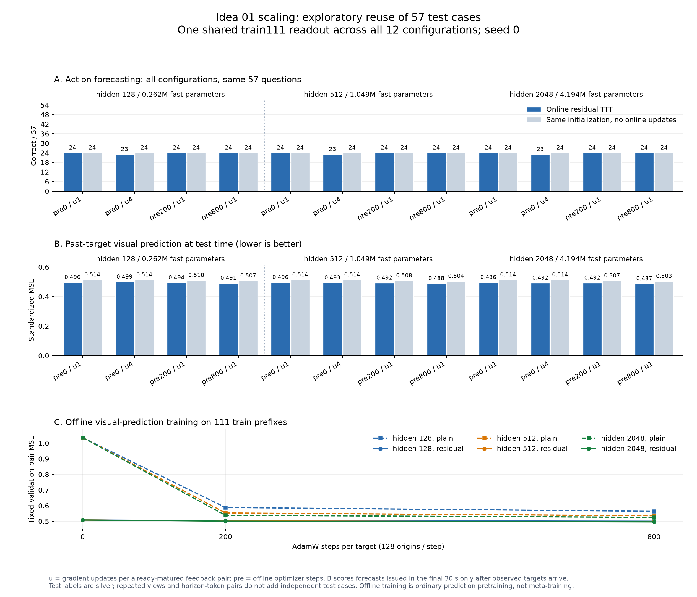

# Idea 01 容量与训练量扩展实验

**已完成：12 个配置 × 200 个完整视频前缀，4 套读出共 77,600 条有效预测。**
fast memory 扩到原来的 16 倍、加入 800 步离线初始化训练后，视觉预测误差下降，
但主比较中的 residual 动作准确率仍为 **24/57（42.11%）**，与对应的 no-update 相同。
把每次在线更新增加到 4 次，三个容量均为 23/57。当前证据不支持单靠扩大这个 MLP
就能解决动作预测问题。

本轮检验上一轮残差 TTT 没有收益，是否与 fast memory 容量小、缺少离线初始化训练或
在线更新量不足有关。实验计划先写入 `runs/forecast_bench_v0/idea01_scaling_v1/plan.json`，
再开始训练和评测。原始实验见 [完整视频 Idea 01 结果](IDEA01_BENCH_V0_MCQ_RESULTS.md)。

## 为什么需要把“训练量”拆开

原始版本每个视频实际已经按时间处理完整 1830 秒、3660 帧，四个 horizon 合计兑现
14,623 次成熟更新；不是只对最终一道测试问题做一次更新。但它的 fast MLP 只有
262,144 个参数值，而且从随机 A / 零 B 开始，没有离线训练初始化。

另一方面，共享语义读出只有 111 道独立训练题，原先的近期 predictor 每个 horizon
最多使用 20,000 个训练 token 行。视频帧、延迟配对、优化 step 与独立动作标签的数量
并不相同。本轮增加训练视频内的预测配对和优化量，不能声称新增了独立人工标签。

## 预先固定的对比

所有配置复用相同冻结视觉缓存、相同 train-only 近期 predictor 和相同按天划分。
第 1–4 天 train 111、第 5 天 validation 32、第 6–7 天 test 57。
此前已查看 test57 的结果，本轮对它的复用属于**探索性扩展比较**。

| 容量 | hidden | fast 参数值 | FP32 fast weights |
|---|---:|---:|---:|
| 原始容量 | 128 | 262,144 | 1 MiB |
| 4 倍容量 | 512 | 1,048,576 | 4 MiB |
| 16 倍容量 | 2048 | 4,194,304 | 16 MiB |

每种容量有四个配置，共 12 个配置：

| 配置 | 离线初始化训练 | 每次成熟反馈的更新次数 |
|---|---:|---:|
| random_u1 | 0 step | 1 |
| random_u4 | 0 step | 4 |
| pre200_u1 | 200 step | 1 |
| pre800_u1 | 800 step | 1 |

增大 hidden 时，MLP 的隐层输出乘 `sqrt(128/hidden)`，更新梯度也包含这个系数，
避免只是因为神经元更多，就把相同学习率下的初始更新幅度放大。hidden=128 的
single-step 配置保留原算法的数值对应关系。

四次在线更新重复使用同一批已成熟配对，不添加未来信息，也不产生四倍独立观测。
每题的 fast state、FIFO 和近期窗口均从头建立，不跨测试题传递记忆。

## 离线初始化训练

只读取训练日的过去视频缓存。在同一条训练序列内采样当前 cue 及其随后
0.5/1/2/5 秒的已观察视觉状态，为 plain 和 residual 两种写入目标分别拟合四组 MLP。
每个 batch 包含 128 个 origin、每个 origin 8 个空间 token；四个 horizon 共享 cue。

| checkpoint | origin 抽样数 | 每种目标的 horizon-token 配对数 |
|---|---:|---:|
| 200 step | 25,600 | 819,200 |
| 800 step | 102,400 | 3,276,800 |

200/800 步实际覆盖 24,785/90,280 个不同的 case-origin，候选池共 405,150 个。
抽样有放回；不同 case 也可能包含重叠视频，不把这些数量称为新增独立视频。
使用 AdamW，学习率 0.001、weight decay 0.01、gradient clipping 1、seed 0。
两个 checkpoint 来自同一条连续训练轨迹。固定 validation 抽样只诊断视觉预测损失，
不使用 test、选择题答案或 `future.mp4`，也不据其调整训练长度。

离线权重在每个 episode 开始时复制到 fast memory。reset 与 tail 对照同样恢复到
对应的已训练初始化。该阶段是普通离线预测预训练，尚未对在线更新过程求 outer 梯度，
因此不能称为完整的 meta/outer training。

## 对照与读出

每种配置都评测 persistence、recent_only、plain_delayed、residual、reset_residual、
recent_tail_residual，以及两个冻结初始化对照 plain_no_update / residual_no_update。
预训练后，必须与同一已训练初始化的 no-update 比，才能判断收益是否来自在线适应。

主比较训练一套共享语义 ridge 读出，所有配置与方法等权，train111 拟合、validation32
选择正则。另做两个诊断：固定原始实验的读出以避免重新拟合掩盖表示差异，以及使用
嵌套的 32/64/111 个训练标签比较读出的数据量。这里变化的是动作 head 的标签数量，
视觉预测器仍固定使用原来的训练视频。

除最终动作准确率外，还统计每题最后 30 秒内发出的、在截止前已成熟的视觉预测 MSE。
预测必须先保存，等目标实际到达后才评分；截止后的真实未来不参与该指标。
报告参数变化、在线梯度步数、内存和耗时，避免只以准确率判断是否发生更新。

## 结果

### 1. 参数量和离线训练量确实影响视觉预测

固定的 512 个 validation origins 上，离线初始化的标准化视觉 MSE 如下。
这是过去前缀内的短期视觉状态预测，不是动作选择题准确率。

| hidden | plain：0 → 200 → 800 step | residual：0 → 200 → 800 step |
|---|---|---|
| 128 | 1.03558 → 0.58818 → 0.56377 | 0.50826 → 0.50426 → 0.50065 |
| 512 | 1.03558 → 0.55338 → 0.53525 | 0.50826 → 0.50220 → 0.49749 |
| 2048 | 1.03558 → 0.53811 → 0.52527 | 0.50826 → 0.50100 → 0.49609 |

因此，新增参数和离线训练能够被优化器有效利用。plain 的变化较大，部分原因是它从
零预测起步；residual 的起点已经包含训练好的近期预测器，改善幅度较小。

### 2. 主比较：动作预测没有随容量稳定提升

下表使用同一个 `shared_n111` 读出。所有 trial/arm 以相同权重参与拟合，每个训练题
总权重为一；96 个方法视图不是 96 道独立题。读出只有一套 `1024×2048` 系数，不接收
方法名称。lambda 在 `[0.01, 0.1, 1, 10, 100]` 中按所有视图的 validation 加权准确率
选择，并列取更大值。本轮三个训练规模都选择 100，仍处于网格边界。

recent_only 在所有配置中均为 validation **14/32**、test **24/57**。

| hidden | 配置 | residual Val /32 | residual Test /57 | 同初始化、无在线更新 Test /57 | plain Test /57 |
|---|---|---:|---:|---:|---:|
| 128 | random_u1 | 13 | 24 | 24 | 24 |
| 128 | random_u4 | 13 | 23 | 24 | 24 |
| 128 | pre200_u1 | 13 | 24 | 24 | 23 |
| 128 | pre800_u1 | 13 | 24 | 24 | 23 |
| 512 | random_u1 | 13 | 24 | 24 | 25 |
| 512 | random_u4 | 13 | 23 | 24 | 23 |
| 512 | pre200_u1 | 14 | 24 | 24 | 23 |
| 512 | pre800_u1 | 13 | 24 | 24 | 23 |
| 2048 | random_u1 | 14 | 24 | 24 | 23 |
| 2048 | random_u4 | 13 | 23 | 24 | 23 |
| 2048 | pre200_u1 | 14 | 24 | 24 | 23 |
| 2048 | pre800_u1 | 13 | 24 | 24 | 23 |

三组 random_u4 相对同初始化 no-update 均是 **0 题由错变对、1 题由对变错**。
其余九组 residual 的正确/错误集合与各自 no-update 相同；其中部分配置会在错误
选项之间改变答案。例如最大 pre800 的 57 题只有 1 个选项改变，两者都答错。
所有配置的 reset_residual 与 recent_tail_residual 在 test 都为 24/57，仍未建立
更早 1800 秒记忆对最终动作选择的收益。

plain 的 25/57 只出现在 hidden512/random_u1；它既不随容量单调增加，也未随
预训练变多而改善。不能从 12 个配置中挑这一项，声称发现了可靠的 scaling 收益。

### 3. 在线更新有效，但视觉 MSE 的收益没有转成动作收益

下面只统计 test57 **已观察前缀最后 30 秒**发出、并在截止前成熟的预测。
每题共 223 个 origin-horizon 配对，每个配对比较 `8×256` 个标准化特征值；先保存
预测，等目标到达后评分。截止后的 `future.mp4` 未用于该指标。
recent_only 的 MSE 为 **0.513887**。

| hidden | 配置 | residual 在线 MSE ↓ | 同初始化冻结 MSE ↓ | plain 在线 MSE ↓ |
|---|---|---:|---:|---:|
| 128 | random_u1 | 0.496274 | 0.513887 | 0.522565 |
| 128 | random_u4 | 0.498833 | 0.513887 | 0.499845 |
| 128 | pre200_u1 | 0.493966 | 0.509897 | 0.504213 |
| 128 | pre800_u1 | 0.491096 | 0.506775 | 0.499222 |
| 512 | random_u1 | 0.496219 | 0.513887 | 0.531016 |
| 512 | random_u4 | 0.493346 | 0.513887 | 0.497048 |
| 512 | pre200_u1 | 0.492247 | 0.507634 | 0.498798 |
| 512 | pre800_u1 | 0.488055 | 0.504029 | 0.493367 |
| 2048 | random_u1 | 0.496337 | 0.513887 | 0.542159 |
| 2048 | random_u4 | 0.491702 | 0.513887 | 0.500428 |
| 2048 | pre200_u1 | 0.491998 | 0.506707 | 0.498519 |
| 2048 | pre800_u1 | 0.487428 | 0.503286 | 0.493445 |

最大 pre800 residual 相对 recent_only 的 MSE 下降约 **5.15%**，相对相同预训练
初始化但不更新的版本下降约 **3.15%**。与原容量 random_u1 的在线版本比较，下降
约 **1.78%**。这是连续视觉预测上的改善，不能替代动作预测的收益证据。

所有 full-history fast arm 每题均兑现 14,623 个成熟更新；u4 的梯度步数为 58,492。
residual 参数相对初始化的 L2 变化均值约 3.05–7.53，no-update 则严格为零。
本轮没有发生“权重没变”或“记忆未参与预测”的问题。

### 4. 读出数据量与冻结旧读出的诊断

训练子集是预先固定、按天交错的嵌套集合，不按标签或结果选取。
这里变化的仅是动作读出标签数量；三个规模仍使用同一个 train111 近期预测器，
pretrained 配置也仍使用 train111 视频，因此不能当作全流程 low-data 实验。

| 读出训练题数 | recent Test /57 | h128 random_u1 residual | h2048 pre800 residual | h2048 pre800 无更新 | text_prior |
|---|---:|---:|---:|---:|---:|
| 32 | 20 | 23 | 23 | 19 | 21 |
| 64 | 25 | 24 | 24 | 24 | 16 |
| 111（主比较） | 24 | 24 | 24 | 24 | 16 |

32 题读出下存在在线更新相对匹配冻结初始化的探索性改善，但扩容量、增加预训练
没有超过同一读出下的 h128/random_u1 residual。64/111 题读出下也未重现这个
改善。小数据读出的波动说明当前结果依赖监督映射，不能把增加标签量解释为单调收益，
也不能依据 test 选出“最好的训练题数”。

复用**上一轮冻结的旧读出**时，全部 12 个 residual 配置仍为 24/57。
plain 为 23–26/57；最高 26/57 是 h512/random_u1，validation 为 10/32，
而同读出的 recent_only 是 14/32。没有重新训练读出也没有显示 residual scaling 收益。



## 架构与本轮改动

```text
train111 的过去视觉配对
  -> 离线拟合 plain/residual 的四 horizon MLP
  -> 每个视频复制相同初始化 θ0

当前过去帧 -> 冻结视觉塔 -> 8×256 token z_t
  ├─ 冻结近期 predictor -> b(t,h)
  └─ cue FIFO -> z_(t+h) 到达 -> θ ← θ - η∇MSE
                         -> B_h [SiLU(A_h z_t) × sqrt(128/hidden)]
截止时：b(t,h) + 残差预测 -> 四 horizon 空间均值 -> 1024维
  -> 所有配置共用的语义 ridge -> 与六个候选文本表示比较
```

本轮扩的是投影后 `256→hidden→256` fast MLP，四个 horizon 的参数量为
`4×(hidden×256 + 256×hidden)`。Qwen 视觉塔、候选文本 decoder、投影维度、
空间池化、近期 predictor、horizon、输入帧数与动作读出形式均保持相同。
**这不是把 Qwen-2B 换成更大的骨干，也不是扩大官方 Spatial-TTT 的语言层 fast weights。**
现有 `8×256` 表征和最后的空间均值仍可能丢失动作、关系或时序信息；新增 MLP
不能恢复编码器已丢弃的信息。本轮也没有 learned key 或任务驱动的 outer loss。

新增实现位于：

- `ttt_frame/idea1_scaling_memory.py`：独立 episode 的 GPU 批处理、容量归一化、
  多次成熟更新、冻结初始化对照及因果 MSE 记录。
- `ttt_frame/idea1_scaling_pretrain.py` / `scripts/pretrain_idea1_scaling.py`：
  train-only 视觉配对采样和初始化训练，保存 0/200/800 step checkpoint。
- `scripts/run_idea1_scaling.py` / `scripts/launch_idea1_scaling.py`：
  预先固定 12 配置、输入与源码校验、8 卡分片和可恢复运行。
- `scripts/evaluate_idea1_scaling.py`：共享读出、训练规模诊断、先固定预测再评分。
- `scripts/summarize_idea1_scaling.py` / `scripts/plot_idea1_scaling.py`：精简归档与结果图。

旧基线和上一轮 Idea 01 的预测实现保持冻结，便于追溯。本轮 h128/random_u1 与旧实现
抽查 train/validation/test 各 3 题，共有方法的输出最大绝对差不超过 `1.20e-6`，
属于 GPU 批处理的浮点微差。

## 运行规模、证据与边界

完整产物位于 `runs/forecast_bench_v0/idea01_scaling_v1/`。12 组均处理全部 200 个
1830 秒前缀；复用上一轮已编码的 732,000 帧缓存，没有重复调用 teacher 或 API。
在线阶段同时使用 8 张卡，墙钟约 **11 分 32 秒**，所有 worker 退出码为零。
3 个离线训练任务含缓存验证、加载共约 20–26 秒/宽度；不能把缓存加载时间算作
GPU 优化时间。预训练加载阶段峰值约 6.2 GiB；在线各配置的 fast weights 仅占
1/4/16 MiB，完整运行还有输入缓存、FIFO、临时矩阵和评分缓存的显存开销。

可审阅的 Git 精简归档位于
[`data/bench_v0_idea01_scaling_v1`](../data/bench_v0_idea01_scaling_v1/results.md)，
包含全部配置/读出结果、四套逐题选择、训练曲线摘要、协议与校验和。
本机 `mcq/report/summary.json` 保留逐题配对，`pretraining/` 保留实际初始化权重，
`forecasts/` 保留 2400 份视觉预测，`integrity_audit.json` 记录独立审计。
最终完整回归测试 **532 passed（48.87 秒）**。检查覆盖多次更新梯度与 autograd
对应、批内 episode 独立、初始化恢复、延迟评分因果性、无 test 标签拟合、协议/产物
损坏拒绝及新运行不依赖手工审计文件的归档流程；52 个归档文件的大小与 SHA 均核验通过。

解释结果时需要保留以下限制：

1. test57 在上一轮已被查看，本轮所有 test 比较均为探索性；只有两个测试录制日，
   同日片段可能重叠，不能按 57 个独立样本计算显著性或从 12 配置中挑最好者。
2. 当前只有 seed 0，没有多 seed 稳健性证据。数据仍使用 silver labels。
3. 200→800 step 同时增加采样配对数和优化次数，未单独隔离“独立训练数据量”的作用。
   独立监督题目总数仍为 train111，尚未新增录制日、人物或人工动作标签。
4. 读出调参只使用 train/validation 的标签。实现会遍历同一个 `answers.jsonl`，
   但先按 split ID 过滤，不把 test 答案字段送入训练或选择；全部预测固定后才统一评分。
5. 本轮与历史 ICL 的输入帧数、监督及计算量不同。它验证同输入的在线/冻结消融，
   尚不能声称对 ICL 的公平胜出。

## 结论与下一步

用户提出的容量和训练量假设已经通过 1×/4×/16× 容量、0/200/800 步初始化训练以及
1/4 次在线更新得到直接比较：**视觉回归可改善，当前动作预测尚无稳定改善。**
因此不建议立即只堆到更大的 MLP 并反复查看同一 test57。

下一步更有针对性的实验是在 train/validation 上加入任务对齐：用短 episode 的
`cue→延迟结果→更新→未来动作` outer objective 学习 key、初始化或读出，保留
同初始化 no-update 对照。同时在新的录制日上保留未查看的测试集，增加真正独立的
训练视频和动作标注。这样才能区分“在线记忆结构未学会存储有用规律”与“标签/读出
不足”，而不是把 MSE 的下降当成动作能力已经提升。

## 查看结果与复现命令

以下命令在 Linux 项目根目录和 `meowbench` 环境执行。已有产物可直接查看，
不需要重新训练或再付 API 费用：

```bash
cd /home/quzitsix/TTT_frame
less docs/IDEA01_SCALING_RESULTS.md
less data/bench_v0_idea01_scaling_v1/results.md

# 从本机已固定的预测和评分重建精简归档；请使用新的输出目录。
conda run --no-capture-output -n meowbench python scripts/summarize_idea1_scaling.py \
  --run-dir runs/forecast_bench_v0/idea01_scaling_v1 \
  --output-dir runs/forecast_bench_v0/idea01_scaling_review
```

从已有视觉缓存重跑整组比较（新输出目录）按以下顺序：

```bash
RUN=runs/forecast_bench_v0/idea01_scaling_reproduce

# 1. 先固定计划。
conda run --no-capture-output -n meowbench python scripts/run_idea1_scaling.py \
  --output-dir "$RUN" --create-plan

# 2. 三个容量各训练一条初始化轨迹；下例依次使用同一张空闲卡。
for H in 128 512 2048; do
  conda run --no-capture-output -n meowbench python scripts/pretrain_idea1_scaling.py \
    --hidden-dim "$H" --steps 200 800 --device cuda:3 \
    --output-dir "$RUN/pretraining/h$H"
done

# 3. 需要八张卡各有至少 2300 MiB 空闲显存，episode 间独立分片。
conda run --no-capture-output -n meowbench python scripts/launch_idea1_scaling.py \
  --output-dir "$RUN"

# 4. 先生成全部候选分数和选择，再单独评分。
conda run --no-capture-output -n meowbench python scripts/evaluate_idea1_scaling.py \
  --plan "$RUN/plan.json" --output-dir "$RUN/mcq" --stage predict
conda run --no-capture-output -n meowbench python scripts/evaluate_idea1_scaling.py \
  --plan "$RUN/plan.json" --output-dir "$RUN/mcq" --stage score

# 5. 精简归档与导出图表。
conda run --no-capture-output -n meowbench python scripts/summarize_idea1_scaling.py \
  --run-dir "$RUN" --output-dir "$RUN/archive"
conda run --no-capture-output -n meowbench python scripts/plot_idea1_scaling.py \
  --run-dir "$RUN" --output-dir "$RUN/figures"
```

`predict`、初始化训练和归档要求新输出目录，避免覆盖已固定的结果。
在线 runner 的 `--resume` 只接受协议、输入和代码校验一致的产物。
