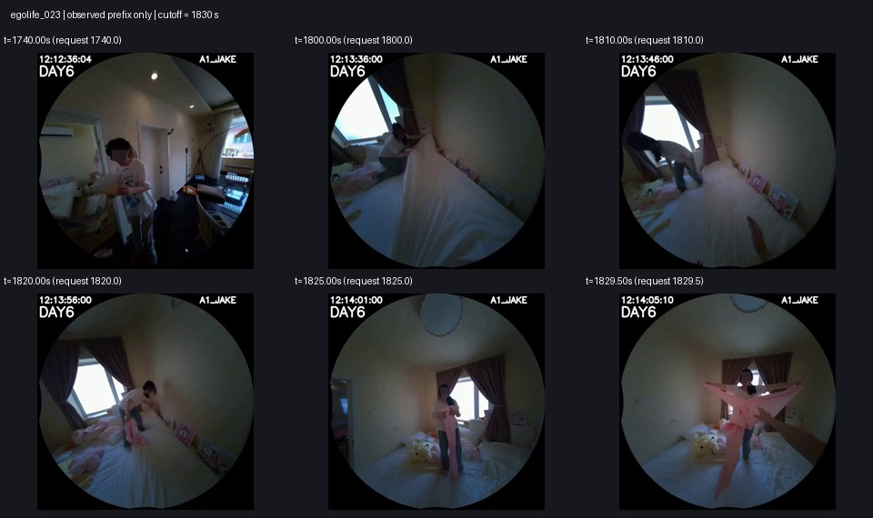
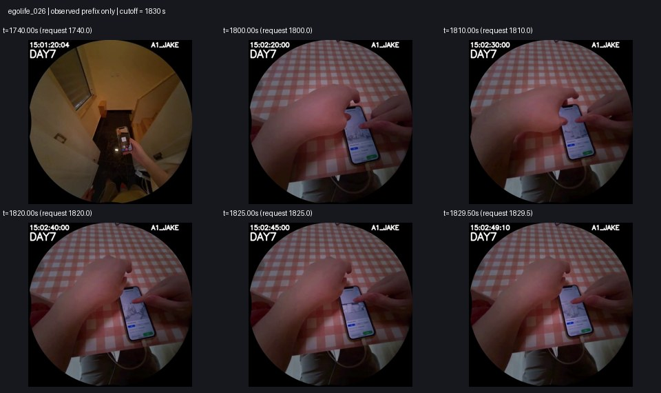

# 五个 Idea 的方向、实验结果与具体回答

更新：2026-10-26。Idea1、Idea3 为此前已完成实验；本轮完成 Idea2、Idea4、Idea5
的真实视频实验及必要对照。本页汇总的是**已经运行的原型与机制预检**，不是五张
研究卡片中全部端到端系统都已实现。

**目前没有建立“在线参数记忆带来稳定 forecasting 收益”的证据。** 更清楚的线索
来自视觉细节与时间预算：同90帧的高清输入比低清多答对10题；同一混合分辨率预算下，
简单固定选择区间末尾已经超过运动策略。相反，坐标搬运未通过预检，查询优化提高
关联目标却降低动作准确率，函数响应压缩保持答案但没有独立收益。

## 1. 各方向到底做了什么

| Idea | 想解决的问题 | 实际尝试 | 结果与判断 |
|---|---|---|---|
| 1：延迟预测残差记忆 | 把近期窗口无法解释、对未来有用的信息写入参数 | 冻结视觉塔，小MLP在后续观测到达后学习预测残差；扩展容量、初始化训练和更新次数 | 视觉MSE下降，主residual与reset/recent均24/57；未建立在线更新的动作收益 |
| 2：坐标搬运 | 同一内容换视角后，搬运已有函数而非重复覆盖 | 200题×12对真实相邻帧；train PCA16；fit/gate/audit分离的正交变换；错误对应/视频对照 | Test684对全部有足够匹配，0对接受；独立误差恶化0.132%。按停止条件不接入完整记忆 |
| 3：查询地址搜索 | 检查信息是否已写入但直接地址读不到 | 官方Spatial原生关联记忆；只优化临时query；direct/reset/wrong-video/fullICL对照 | 搜索6/57，直接9/57，错视频搜索9/57；未建立当前视频特异性收益 |
| 4：函数响应状态 | 用少量探测点响应替代权重和在线反传 | 重放Idea1教师真实轨迹；32/64/128 probes；固定/状态相关RBF；完整前缀学生和教师辅助20步诊断 | 所有val/test选项完全相同，均24/57；512KiB状态替代1MiB，但本地未融合写入约慢10倍 |
| 5：按需获取细节 | 把高清预算花在有用的时刻 | 相同90个源帧、六个预先固定配置；另补固定区间末尾的事后归因对照 | 高清25/57、低清15/57；固定末尾24/57优于运动22/57。支持继续研究细节/时序预算，未支持记忆条件策略的增量 |

Idea2 没有动作回答，不能把预检失败写成准确率0。Idea4 是 **Idea1教师的函数空间
原型**，Idea5 是 **感知和预算预检**；二者都没有冒充完整官方Spatial或完整原提案。
Idea3的text-V候选目标没有训练视觉语义对齐。未运行的完整训练、人工recall/身份
验证和大规模多种子比较，都不包含在本轮“完成”声明中。

## 2. 实际 forecasting 成绩

所有动作成绩均沿用 train111（第1–4天）、validation32（第5天）、test57（第6–7天）
的整天划分，所有佩戴者共同分组，每题独立初始化。预测只用cutoff前视频和公开选项，
测试答案只在预测冻结后评分。下面题集相同，但**输入、模型和监督预算并不相同**。

| 方法 | Validation32 | Test57 | Test准确率 | 主要预算/范围 |
|---|---:|---:|---:|---|
| 旧Qwen full ICL | 6/32 | 21/57 | 36.84% | 90帧224，零样本选项字母读出 |
| 旧Qwen recent ICL | 4/32 | 23/57 | 40.35% | 仅近期60帧224 |
| Idea1 recent / residual / reset | 14/32 | 24/57 | 42.11% | 3660帧224，train监督共享读出 |
| Idea1 plain delayed（已有比较） | 10/32 | 25/57 | 43.86% | 同3660帧和共享读出，不是主residual结果 |
| Idea3 direct | 8/32 | 9/57 | 15.79% | 官方Spatial，90帧224，未对齐的text-V目标 |
| Idea3 query search | 6/32 | 6/57 | 10.53% | 同上，额外三步地址搜索 |
| Idea3 reset / frozen | 4/32 | 3/57 | 5.26% | 新候选似然读出，不等于旧blind读出 |
| Idea3 wrong-video search | 2/32 | 9/57 | 15.79% | 换成固定其他训练视频记忆 |
| Idea4 fixed / conditioned full | 14/32 | 24/57 | 42.11% | 同Idea1输入/读出，128探测点，完整前缀前向递推 |
| Idea5 low112 | 4/32 | 15/57 | 26.32% | 90帧，处理器实际约128，720视觉token |
| Idea5 mid224 | 6/32 | 21/57 | 36.84% | 90帧，2205视觉token |
| Idea5 high448 | 8/32 | 25/57 | 43.86% | 90帧，8820视觉token |
| Idea5 uniform high | 9/32 | 16/57 | 28.07% | 24帧高清+66帧低清，2880视觉token |
| Idea5 random high | 7/32 | 17/57 | 29.82% | 同上，固定随机种子 |
| Idea5 motion high | 8/32 | 22/57 | 38.60% | 同上，仅当前/过去缩略图决策 |
| Idea5 fixed deadline，事后对照 | 10/32 | 24/57 | 42.11% | 同上，每个预算区间固定选最后一块 |

Idea5的六主组在评分前全部固定；若在这六组中按validation正确数选配置，胜者是
uniform（9/32），对应test为16/57。不能看完test后把motion或high说成事先选定的
赢家。固定deadline是在主实验之后为检验“运动还是近期证据”追加的归因对照，
设计时已经看过主结果；虽在它自己的预测生成期间不读答案，也不构成新独立测试。

Idea5同轮共享相同90个448源帧，分成15块、每块6帧，四个预算区间各可选一块高清。
它与旧fullICL的请求/实际时间戳200/200一致，但新mid224从448再次缩放，像素与旧
直接224缩放200题均不一致，且视频包装不同。因此新旧21/57不是相同预测或纯分块
消融；六组内部才是共享源像素和包装的分辨率/策略比较。

几个有用的配对比较：

| Test57左侧相对右侧 | 改对 | 改错 | 净增正确数 |
|---|---:|---:|---:|
| Idea3搜索 vs 直接读取 | 3 | 6 | -3 |
| Idea3搜索 vs 旧fullICL | 3 | 18 | -15 |
| Idea4完整学生 vs 教师 | 0 | 0 | 0 |
| Idea5全高清 vs 低清 | 15 | 5 | +10 |
| Idea5运动 vs 固定区间首块 | 9 | 3 | +6 |
| Idea5固定区间末块 vs 运动 | 3 | 1 | +2 |
| Idea5固定区间末块 vs 全高清 | 2 | 3 | -1 |

“改对”是左方法正确、右方法错误；“改错”相反。高清并非单调改进每一道题。
运动组比mid224仅多对1题，却多30.6%视觉token，也未建立优于统一中清的稳定预算优势。

## 3. 具体回答：实际选了什么

完整200题×25方法/对照的选项文字和正确性见
[answers.csv](../data/bench_v0_ideax_summary_v1/answers.csv)；
[逐例对照Markdown](../data/bench_v0_ideax_summary_v1/concrete_answers.md)
列出8个例子的六个原始选项和各方法选择。

以下例子按冻结的配对规则选取：每组比较中，取字典序最早且尚未展示的改对/改错题，
再补全部错误等例子。因此它们是**按结果选取的事后分析**，不代表随机抽样，也不用于
调整模型。这里的“回答”是模型实际选择的原始MCQ选项，未生成自由文本解释。

| 题目 | 银标签参考 | 实际回答对比 | 能说明什么 |
|---|---|---|---|
| egolife_023 | 我接过了这个床单 | 低清/旧fullICL：我整理了一下枕头；高清/运动：我接过了这个床单；Idea1/4：我把被子叠整齐了 | 场景都在床边，但具体交互对象和动作不同；此例细节输入改对 |
| egolife_024 | 我打开刚才的黑色软件 | 低清和Idea1/4正确；高清/运动/旧fullICL：我摘下头上的耳机 | 高清也会改错，不能把全部收益归因于看清屏幕 |
| egolife_027 | 我拿起另一个杯子 | 固定首块/低清/Idea1/4：我拿起一瓶酱油；运动/高清/旧fullICL正确 | 同一厨房场景下，选择哪些帧用高清会改变对象判断；不能仅凭此例归因于运动机制 |
| egolife_093 | 我喝了一口矿泉水 | 固定首块/高清/旧fullICL正确；运动/低清/Idea1/4：我调整了一下耳机 | 运动策略同样有损失，不是固定策略的逐题改进 |
| egolife_090 | 我接过了快递 | Idea3搜索正确；Idea1/4：我把包裹放回去了；多个ICL配置也正确 | 搜索确有个别改对，但总计改错更多，不能用此例掩盖总体负结果 |
| egolife_058 | 我打开了盖子 | Idea3直接读取正确，搜索改为我喝了一口水；多数ICL：我站起来吃饭 | 提高关联目标不保证候选排序更符合真实动作 |
| egolife_026 | 我点击手机屏幕呼出键盘 | 旧fullICL/低清：我触摸手机屏幕确认地址；高清/运动：我操作手机屏幕切换应用；Idea1/4：我长按手机屏幕刷新页面 | 模型识别到手机操作，却未区分具体功能；全部展示方法均错 |
| egolife_022 | 我喝了一口酸奶 | 多个ICL正确；Idea1/4：我把酸奶倒在地上；Idea3搜索：我喝了一大口牛奶 | 语义读出会出现不合理对象/动作替换，相同答案不能证明有效记忆被保留 |

我还回看了这8题各6张**cutoff前**画面（历史1740秒，近期0/10/20/25/29.5秒）。
这是可见前缀检查，没有读取future视频，也不是人工确认银标签。

在023的最后可见画面中，对面的人正展开浅粉色布料，佩戴者的手伸向前方；这与接取
布料的预测有可见关联。但单帧不能确认未来是否真的接到，且“床单”的对象命名仍依赖
参考标签。024显示佩戴者在床上操作笔记本，屏幕内容较小；从这些抽帧不能确认将打开
哪个软件，也没有足够证据为“摘耳机”补写理由。026显示手机界面和手部操作，但小字、
点击目标与下一步功能难从总览中分清，说明细粒度动作区分仍是难点。





其余画面与请求/实际时间戳、像素SHA在
[context_review](../data/bench_v0_ideax_summary_v1/context_review)。这些解释来自本次
事后画面阅读，不能当作模型内部推理过程或统计归因。

## 4. 方向判断与接下来值得解决的问题

**优先研究细节与时间预算，但先建立简单基线。** 固定区间末尾用2880视觉token得到
24/57，全高清8820得到25/57，是值得在新数据上确认的预算线索。应先比较统一中清、
固定偏近期、变化/不确定性阈值和显式检索，再研究依赖记忆的获取或RL策略。当前固定
末尾已经超过运动，复杂机制必须证明其增量，不能只和较弱固定首块比较。

**先把记忆对答案的作用做实，再扩容量或蒸馏。** Idea1/4的连续输出确实在变化，
但residual、reset、copy和完整学生在val/test的动作答案相同。此时仅用动作准确率
蒸馏一个同样的教师，无法证明长时记忆有效。需要明确哪些题必须依赖较早证据，审计
近期可答/历史必要两类，再做错视频、删除关键历史、冻结状态和相同预算检索对照。

**暂缓当前坐标搬运和未对齐关联搜索。** Idea2在独立对应上的增益不成立；Idea3
搜索当前目标反而把答案改差。优先解决真实匹配/语义目标对齐，而不是仅增加变换或
搜索步数。这不排除训练后的可变换key或同一事实的文本/视觉地址会有不同结果。

**RL仍是待检验工具。** 获取/写入决策能改变后续可用信息，适合提出有状态转移的
决策问题；但部署时没有密集动作真值，不能把最终测试答案当在线奖励。先明确状态、
动作、合法延迟反馈、信用跨度和成本，并与同反馈监督gate、CE/MSE、固定/随机策略
比较。把当前不对齐的关联分数直接命名为reward，不会自动修复任务对齐。

## 5. 产物、复现与限制

| 内容 | 入口 |
|---|---|
| Idea1与scaling | [动作评测](IDEA01_BENCH_V0_MCQ_RESULTS.md)、[scaling](IDEA01_SCALING_RESULTS.md) |
| Idea2方向与预检 | [完整报告](IDEA02_BENCH_V0_RESULTS.md)、[归档](../data/bench_v0_idea02_v1) |
| Idea3方向与搜索 | [完整报告](IDEA03_BENCH_V0_RESULTS.md)、[归档](../data/bench_v0_idea03_spatial_v1) |
| Idea4方向与蒸馏 | [完整报告](IDEA04_BENCH_V0_RESULTS.md)、[归档](../data/bench_v0_idea04_v1) |
| Idea5方向与预算 | [完整报告](IDEA05_BENCH_V0_RESULTS.md)、[归档及末块补充](../data/bench_v0_idea05_v1) |
| 跨方向实际回答 | [200题CSV](../data/bench_v0_ideax_summary_v1/answers.csv)、[例子Markdown](../data/bench_v0_ideax_summary_v1/concrete_answers.md) |
| 会话执行记录 | [交接与完成情况](SESSION_HANDOFF_IDEAS245_20261026.md) |

源码基于 `8e1d524deabb7ed5eba5427833f633629ee0e2dc`，各新协议保存源码和输入产物
SHA。没有修改旧实验冻结模块，没有覆盖原始`ideax_output/`。各方向完整复现命令、
种子、模型来源、离线训练范围和成本在上述报告。使用本地模型与conda `meowbench`，
没有付费API和新依赖安装。

所有实验均已实际完成；Idea2停止在未通过的机制门槛，Idea4停止在无增量/当前实现
成本不优的原型，Idea5完成主组和事后归因。完整提案中的outer训练、TTT条件selector、
独立人工标签和新录制日确认性评测尚未运行。

测试命令（显式离线，避免旧CLIP处理器探测网络）：

```bash
cd /home/quzitsix/TTT_frame
HF_HUB_OFFLINE=1 TRANSFORMERS_OFFLINE=1 \
  conda run --no-capture-output -n meowbench python -m pytest -q

conda run --no-capture-output -n meowbench python scripts/summarize_ideax_answers.py \
  --config data/bench_v0_ideax_summary_v1/config.json \
  --output-dir runs/forecast_bench_v0/ideax_summary_reproduce
```

最终全仓测试 **711 passed in 33.78s**，日志保存于汇总归档的`verification/`。
首次全测710项通过，旧CLIP测试因网络探测超时失败；显式离线单项与全仓复测均通过，
未改变测试断言或旧源码。首次失败日志也保留，避免只保留成功记录。

test57已反复探索、仅两天、窗口重叠且为银标签。1题约1.75个百分点，25与24之间
尤其不能当稳定胜负；多配置和事后对照也增加选择偏差。以上用于决定下一轮研究，
不包装为独立人工核验或显著性结论。
