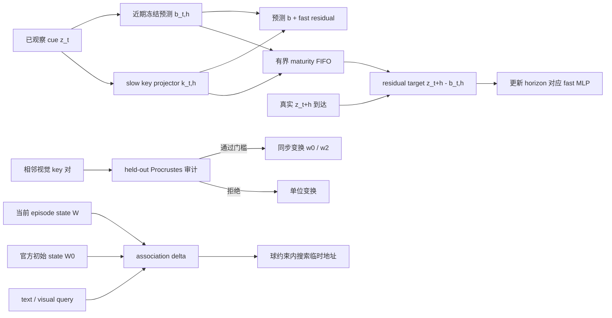

# IdeaX 方案筛选与第一阶段实现

更新日期：2026-10-20

2026-10-25 后续：Idea3 已接入官方 Spatial checkpoint 的原生关联记忆，
同 90 帧真实视频评测和 reset/wrong-video 对照见
[IDEA03_BENCH_V0_RESULTS.md](IDEA03_BENCH_V0_RESULTS.md)。该实验是未训练 text-V
代理目标的寻址诊断，非完整端到端 Idea3；下文保留首次筛选时的状态。
后续 RL 研究输入见 [ideax_input.md](../ideax_input.md)。

后续进展：新 EgoLife forecasting 数据 `bench_v0` 的 Idea 01 数据接口、因果特征
缓存与在线预测预检见 [IDEA01_BENCH_V0.md](IDEA01_BENCH_V0.md)。以下保留首次筛选记录。

本文核对 `ideax_output` 中五份研究卡片与当前仓库、HomeSentinel 数据和
Spatial-TTT 实现，给出现在适合推进的最小实现。研究卡片本身是方案，不是实验
结果；本文也把“算子测试通过”“真实数据假设成立”“端到端任务有效”分开记录。

## 结论与优先级

| Idea | 当前决定 | 已完成的第一阶段 | 进入下一阶段的条件 |
|---|---|---|---|
| 1. Predict What the Recent Window Cannot | **P0，先推进** | 实现因果的 delayed residual fast memory；实现 HomeSentinel 时间候选生成器 | 人工核验出足够的重复 cue→outcome episode，并证明 residual 比 plain delayed target 更可预测 |
| 2. Move the Coordinates, Keep the Memory | **P0，先做可否定预检** | 实现正则化正交 Procrustes、held-out 拒绝规则及 SwiGLU 输入坐标同步变换 | 真实冻结视觉 token 上 held-out 误差相对 identity 至少下降 15%，错误匹配不产生相同改善 |
| 3. Read Fast Weights by Searching the Address | **P0/P1，先诊断读出瓶颈** | 实现 episode-minus-reset 关联分数和受限 inverse-address search | 同一事实的 visual key 读出显著优于 text key，且错 episode 不产生同样增益 |
| 4. Remember Function Responses, Not Optimizer Weights | **暂缓完整实现** | 只保留算子级设计 | 先采集真实 fast-weight 连续写入轨迹，证明有限 probe response 足以预测 20 步后的函数状态 |
| 5. Acquire the Detail Missing from Memory | **暂缓 selector** | 保留 low/high oracle 实验定义 | 先人工核验 20–30 个纯视觉事件，并证明 high-resolution oracle 相对 low-resolution 确实改善记忆任务 |

Idea 1 直接对应项目的预测目标。Idea 2 和 Idea 3 的前置检查成本低，而且能分别
回答“写入地址是否随视角漂移”和“信息是否已经写入、只是文本读不到”。Idea 4
依赖可靠的教师状态轨迹；Idea 5 依赖低清/高清反事实标签。现在直接训练 Idea 4/5
会同时混入数据、写入、读取和视觉预算四类变量，无法定位效果来源。

## 已实现的三个机制



### Idea 1：延迟残差写入

[`ttt_frame/predictive_memory.py`](../ttt_frame/predictive_memory.py) 提供独立于完整
21 层 Spatial 模型的小型机制：

- `DelayedResidualMemory.schedule()` 在时刻 `t` 只读取当前 key 和近期预测，输出
  `baseline + fast_residual`，随后把 `(due_step, key, baseline)` 放入 FIFO。
- `mature()` 只有在 `t+h` 的真实 target 到达后才更新对应 horizon 的 MLP；跳过
  maturity 时刻会直接报错，避免把较晚帧悄悄当成原 horizon 的监督。
- `baseline` 和 `target` 在 inner update 中停止梯度。手写 MSE 更新仍保留 outer
  differentiability，可训练 slow initialization 和上游 key projector。
- 默认 `dim=256`、`hidden_dim=128`、四个 horizon，fast weights 为 262,144 个
  FP32 值，即 1 MiB；FIFO 默认最多 40 个 cue，实际字节数由 pooled token 数决定。
- 初始输出矩阵为零，所以 cold start 精确等于 recent-only baseline。

这是一套冻结特征实验算子，尚未接入 Qwen 的 21 个 Spatial layer，也没有产生真实
任务精度。这样可先比较 same-time association、plain delayed、delayed residual、
GRU/Mamba 和 explicit bank，再决定是否改完整模型。

### Idea 2：key 坐标搬运

[`ttt_frame/key_transport.py`](../ttt_frame/key_transport.py) 明确采用以下约定：样本
key 是行向量，返回的 `R` 是列向量映射，因此 `x_new = x_old @ R.T`。模块包含：

- 正则化 orthogonal Procrustes：
  `min ||X R.T - Y||² + lambda ||R-I||²`；
- fit 与 held-out RMSE、相对改善率；
- scene cut、匹配不足、held-out 改善不足和 RMSE 超限时拒绝变换；
- 拒绝时实际返回单位阵，同时保留 candidate matrix 供诊断；
- 对当前 Spatial SwiGLU 同时执行 `w0 <- w0 R.T`、`w2 <- w2 R.T`，`w1`
  保持不变。对正交 `R`，变换后的新 key 与旧函数严格等价。

这个模块只验证代数和真实 key 是否近似遵循低维正交变换。它还没有直接修改 live
Spatial state。正式接入前必须在 chunk boundary flush pending token，并同步处理
`w0/w2` momentum、文本 query 坐标和坐标版本；这些状态没有完成前，不应把 preflight
矩阵直接写入现有 checkpoint。

### Idea 3：episode-minus-reset 寻址诊断

[`ttt_frame/spatial_probe.py`](../ttt_frame/spatial_probe.py) 使用当前项目真正的写入
目标：Spatial fast memory 通过 `f_W(k) dot v` 做关联上升，因此诊断分数为：

```text
delta(q, v) = <f_W(q), v> - <f_W0(q), v>
```

这里 `W0` 应是同一 official slow checkpoint 的 learned initial state，`W` 是视频写入
后的 state。`association_delta()` 可比较 visual key、text key、随机 key 和错 episode；
`projected_inverse_address_search()` 只优化临时 query，在每个 head/token 的 L2 球内
搜索，保存 direct 与全部迭代中 objective 最好的地址；`W/W0` 全程 detach 且不修改。
候选答案接口对每个 target 独立搜索，因此重排候选只会重排输出。

这是适配当前 Spatial 关联规则的最小诊断版本，并非 Idea 卡片中完整的归一化 MSE
分类器。只有 visual-key 能读出而 text-key 不能时，才值得训练文本地址 projector 或
完整 inverse reader。visual-key 也没有增量时，问题位于写入或覆盖环节。

## HomeSentinel 候选审计

[`ttt_frame/predictive_dataset.py`](../ttt_frame/predictive_dataset.py) 和
[`scripts/prepare_homesentinel_temporal_pilot.py`](../scripts/prepare_homesentinel_temporal_pilot.py)
只生成回看队列：

- 使用完整 evidence ID，支持 `5ag...-1` 一类带连字符的视频 ID；
- `dataset_meta.valid_scenes` 提供真实媒体时间范围；自动 caption event 时间只用于
  候选排序；
- 只保留同一个视频、同名物体、状态文本不同且间隔达到门槛的观测对；
- 每条候选都写入 `human_verified: false`，人工问题、答案、干扰项和精确证据时间均
  保持为空；
- 未解析引用、索引问题和跳过原因全部写入 diagnostics。

在本机完整 Asuka 元数据上使用 `min-gap=30` 得到：

| 项目 | 数量 |
|---|---:|
| object 文件 | 52 |
| evidence index | 1,400 |
| 候选引用到的 evidence | 326 |
| 待人工核验候选 | 224 |
| 有候选的视频 | 45 |
| 未解析 evidence 引用 | 29 |
| evidence index 问题 | 14 |

224 是自动检索结果，不是 224 条可训练真值。人工需要核验同名文本是否真是同一物体、
两次状态是否可见、顺序是否正确、cutoff 是否排除答案画面，以及问题能否仅凭视频
作答。建议先核验 30 条，估算通过率；通过率足够再扩到至少 60 个独立 episode。

运行命令：

```bash
cd /home/quzitsix/TTT_frame
conda run --no-capture-output -n meowbench \
  python scripts/prepare_homesentinel_temporal_pilot.py \
  --data-root /data/HomeSentinel/asuka \
  --min-gap 30 \
  --output runs/ideax/homesentinel_temporal_candidates_v1.json
```

输出文件约 2.3 MiB，保存在 git 忽略的 `runs/` 中。它包含源视频路径与建议的 C2
latest-state、C3 delayed-binding/revisit 问题模板，可直接作为人工回看队列。

## 与当前 Spatial-TTT 状态的尺寸差异

Idea 卡片按“小 adapter”估算 4 个 block、约 1 MiB fast state。当前仓库的
Qwen3-VL-2B Spatial 路径实际在 21 层放置 fast memory，每层 4 个 head、每 head
512 维：

```text
21 layers × 3 matrices × 4 heads × 512 × 512
= 66,060,288 FP32 values
= 252 MiB fast weights
```

启用 momentum 后再增加约 252 MiB；此外还有 norm target、pending token 和 slow
参数。因此第一阶段模块保持独立，不把卡片中 1 MiB 的延迟、显存和 FLOPs 估算套到
现有 21 层模型上。完整集成必须重新报告实际 state bytes 和吞吐。

## 验证结果与复现

新增测试覆盖：未来信息不泄漏、maturity 时序、outer gradient、FIFO 上限、正交性、
held-out 拒绝、SwiGLU 函数等价、per-head transform、episode/reset 零分、真实写入
关联增量、搜索球约束、状态不变、候选重排、非有限输入和过大步长回退。

```bash
cd /home/quzitsix/TTT_frame
conda run --no-capture-output -n meowbench python -m pytest -q \
  tests/test_predictive_memory.py \
  tests/test_predictive_dataset.py \
  tests/test_key_transport.py \
  tests/test_spatial_probe.py \
  tests/test_spatial_memory.py \
  tests/test_spatial_model.py \
  tests/test_spatial_trainer.py
```

结果为 `89 passed`；仓库完整测试为 `179 passed`。这些结果证明实现的因果边界、
张量约定和状态不变性，尚未证明任一 Idea 能提升真实视频任务准确率。本轮检查时 8 张
GPU 都有其他进程占用，因此没有抢占设备，也没有启动 Qwen 特征提取或训练。

## 下一轮执行顺序

1. 从 224 条队列中人工核验 30 条，记录 object identity、两次精确证据时刻、cutoff、
   当前不可见性和可回答性；按原视频/连续事件分组，禁止把相邻 query 当独立样本。
2. 对通过样本一次性缓存相同的冻结、严格因果视觉特征。先跑 Idea 1 的 recent-only、
   plain delayed、delayed residual、reset、GRU/Mamba 和 explicit bank。
3. 从自然相邻帧提取匹配 token，运行 Idea 2 的 16 维 fit/held-out 检验。改善小于
   15%、错匹配也改善或真实状态变化被压制时停止该路线。
4. 在相同事件和 Spatial layer 上捕获写入 visual `k/v` 与 text query，运行 Idea 3
   的 direct visual、direct text、inverse text、reset 和 wrong-episode 五组诊断。
5. 只有 Idea 1 获得真实任务增益，或 Idea 2/3 的前置假设通过，才接入完整 Spatial
   wrapper 并分配多卡训练。Idea 4 等待连续状态轨迹；Idea 5 先做 low/high oracle。

这套顺序让每次 GPU 投入都对应一个已经通过的数据或机制门槛，也保留得出“参数记忆
没有优于显式 bank/递归状态”的有效结论。
