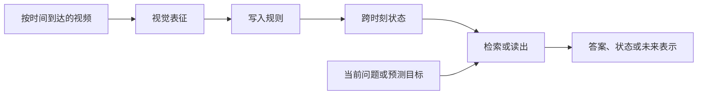

# 第一人称视频记忆、预测与 TTT 架构总对比

整理日期：2026-10-20。

本文是本仓库关于视频记忆架构的总入口，统一回答四个问题：

1. Spatial-TTT、JEPA、StreamTTT、LoRA、显式记忆和其他方法究竟更新什么；
2. 哪些方法有时间顺序、长期状态或未来预测能力，哪些只有视觉表征；
3. 本仓库已经得到哪些可比结果，哪些方法仍只有调研或待部署；
4. counting 不再作为主任务后，下一轮实验 C 应怎样设计。

这里的“全对比”是 **架构、监督条件、适用任务与当前证据的完整矩阵**，不是把不同
训练方式和 readout 的分数拼成一个排行榜。目前还没有在同一真实视频、同一帧预算、
同一监督和同一读出下完成 Spatial-TTT、V-JEPA、StreamTTT 等全部方法的实证排名。

## 1. 当前决策

SVCBench Natural9 保留为 **B3：真实视频 counting 诊断**，不再作为实验 C 的主结论。
实验 C 重新用于直接检验时间和预测能力：

- C1：事件顺序与 block-swap 反事实；
- C2：latest-state / latest-location 覆盖；
- C3：延迟对象—人物—位置绑定与 revisit；
- C4：相邻事件、before/after 与最近事件；
- C5：下一动作或未来状态预测。

Natural9 仍有价值。它验证了真实视频摄入、严格 cutoff、五臂配对和长前缀写入管线，
也暴露了数值输出坍缩。但 counting 同时混合目标检测、跨视角重识别、事件分段、去重、
累加和数字生成。答错一个数时，无法判断模型是没有看到事件、没有绑定时间、忘记了状态，
还是只不会输出正确数字，因此它不适合作为当前项目唯一或主要的时间记忆结论。

Spatial-TTT 也不能被简单写成“原理上不适合 counting”。官方训练和评测本身包含 object
counting；问题在于其长期状态没有显式时钟、事件索引或整数计数器。时间信息来自因果输入
顺序、位置编码、局部滑窗、3D depthwise convolution 和 chunk 的先后，而 LaCT 的大块
fast-weight 更新会在块内聚合 token 梯度。对本项目而言，直接交换事件顺序或改变 cutoff
比只看最终计数更能判断 fast state 是否真正编码了时间。

## 2. 统一拆解方法的五个轴

任何视频记忆方法都可以拆成五部分：

| 轴 | 需要问的问题 |
|---|---|
| 视觉表征 | 是否能识别对象、动作、人物、位置和遮挡后的同一实体？ |
| 写入信号 | 是关联学习、teacher 文本、预测误差、任务监督，还是规则化更新？ |
| 状态载体 | 历史 token/KV、外部帧库、结构化表、递归 hidden state，还是模型参数？ |
| 时间机制 | 是否显式保存时间戳/事件索引；能否区分先后、最近一次和状态覆盖？ |
| 读出 | 是零样本 VLM、监督 probe、检索、状态头，还是未来 latent matching？ |

如果两个方法在其中多个轴上同时不同，绝对分数不能只归因于“记忆架构更强”。

## 3. 架构总表

状态列说明：**实测**表示本仓库已有结果；**实现**表示代码路径存在但没有匹配的完整比较；
**调研**表示目前只有论文或外部实现分析。

| 方法 | 跨时刻状态 | 测试时更新 | 时间顺序来源 | 原生预测目标 | QA 接口 | 本仓库状态 |
|---|---|---|---|---|---|---|
| Long-context ICL | 历史视觉 token / KV | 否 | 位置编码和完整上下文 | 否 | 直接 | **实测**；Natural9、C-PNG |
| 显式帧检索 | 带时间戳的帧/feature 库 | 写外部索引，不改模型 | 显式时间元数据 | 否 | 检索后交给 VLM | **未实现统一视觉臂**；只有零散取帧工具 |
| 显式状态表（事件图待实现） | object、location、actor、state、time | 规则或学习式更新 | 显式 event time / last-write | 可另接 predictor | 直接或模板化 | 仅 symbolic table **实测**；event graph 与真实视觉待接 |
| VideoQA LoRA-TTT | Q/V LoRA 参数 | teacher 文本 CE 更新 | 顺序 SGD 和提示中的时间戳 | 否 | 直接 | **实测**；有额外 teacher 监督 |
| Spatial-TTT | VLM 多层 SwiGLU fast weights | 视觉 K/V 关联更新 | 因果 chunk、RoPE、SWA、3D conv | 空间关联，不是显式未来帧 | 直接 | **实测**；官方 nano checkpoint |
| standalone LaCT | 64-D symbolic fast weights | 合成 key/value 关联更新 | 样本顺序与 chunk 更新 | 否 | symbolic 分类头 | C-PNG mechanism arm **实测**；未单独接入视觉/VLM |
| StreamTTT | 短 KV + 每层 E²-TTT fast weights | 在线 fast-weight 更新 | 短期 KV、全局位置和逐 token dynamics | 以流式/长视频 QA 训练 | 直接 | **调研**；发布代码/权重，未部署 |
| V-JEPA 2 | clip latent；默认无持久 episode state | 通常否 | 视频 tubelet/时空 encoder | masked latent prediction | 需 probe 或 VLM 对齐 | C-PNG ViT-L frozen probe **实测** |
| V-JEPA 2.1 | clip latent；默认无持久 episode state | 通常否 | tubelet 时空位置与视频 encoder | dense latent prediction（context 与 masked token）和深层自监督 | 需 probe 或 VLM 对齐 | **调研**；未实测 |
| V-JEPA 2-AC | 当前/初始观测 latent 与 action rollout；无任意长 episode state | 通常否 | 动作条件和 latent rollout | 未来 latent / planning | 需任务头 | **调研**；未实测 |
| V-JEPA + explicit/recurrent state | 外部表、GRU/SSM 或 fast weights | 取决于状态模块 | 由外挂状态决定 | 可保留 JEPA predictor | 需统一 head | **未实现**，是公平 JEPA 主臂 |
| TTT-Linear / TTT-MLP | 线性层或两层 MLP 充当递归 hidden state | 每个 token 做自监督更新 | 因果 token 顺序 | 取决于外层任务 | 原版是语言模型 | **调研**；基础 TTT 层对照 |
| E²-TTT | fast weights、动量、衰减状态 | 闭式 chunk 更新 | 保留 token-dependent 更新动态 | 取决于外层任务 | 不是独立 VLM | **调研**；更适合作为更新器消融 |
| ViT³ | 视觉 TTT 层的 fast weights | 视觉 key/value 在线学习 | 图像/视觉 token 顺序 | 原版覆盖分类、生成、检测、分割 | 无长视频 QA 接口 | **调研**；未部署 |
| TTT Video-DiT | TTT-MLP 形成的全局视频 latent 状态 | 前向时由 key/value 自监督目标更新 | 全局与反向视频 latent 顺序 | 长视频扩散生成 | 无 QA 接口 | **调研**；生成基线，不是 episode QA memory |
| FFN | 持续适配参数 + 小缓冲 | prediction-surprise 触发 | 显式时间编码和相邻帧预测 | 下一帧/latent surprise | 原版不做长期 QA | **调研**；适合作为写入 gate |
| Online Video TTT | 持续 backbone 参数 | MAE 等自监督更新 | 当前帧和近期窗口 | 当前帧重建 | 原版不做长期 QA | **调研**；域适应控制 |
| TTT-E2E | 普通 Transformer 权重 | next-token prediction | 因果 token 顺序 | 下一 token | 当前为语言模型 | **调研**；训练原则参考 |
| Titans / MIRAS | 深层 neural memory | surprise、momentum、forgetting | 序列更新与 retention 机制 | 取决于训练目标 | 当前主要是序列/语言 | **调研**；无匹配视觉 checkpoint |
| Mamba / DeltaNet / SSM | 固定递归 hidden state | 不做梯度更新 | 离线学到的因果 recurrence | 取决于训练任务 | 需视频 QA 头 | **未实现**；判断 TTT 是否必要 |
| SAM 2 | 对象 mask feature 与 object pointer memory | 写外部 memory bank | 逐帧 memory attention | 下一帧对象 mask | 不是通用 QA | **调研**；对象身份/遮挡/revisit 对照 |
| MA-LMM / MovieChat | 压缩后的视觉 token memory | 外部 token 更新 | 分层/短长时记忆 | 视频语言监督 | 直接 | **调研**；长视频 QA 对照 |
| VideoMindPalace | 对象—活动区域—房间三层图；边含交互与时空关系 | 显式图构建 | 边上的交互、时空与布局关系 | 否 | 图检索后回答 | **调研**；结构化 memory 对照 |
| World-T³ | pose-conditioned 3D world fast weights | RLS 在线更新 pose-keyed fast weights | 位姿、观测顺序和递归更新 | 长程世界生成/revisit | 不是通用 QA | **调研**；需要位姿和专门训练 |
| Fast Spatial Memory / LaCET | 4D 空间记忆状态 | elastic TTT 更新 | 空间坐标、时间和递归更新 | 空间记忆与重访 | 不是通用 QA | **调研**；需要专门训练 |

主要一手资料：

- [Spatial-TTT 论文](https://arxiv.org/abs/2603.12255)与[官方实现](https://github.com/THU-SI/Spatial-TTT)
- [StreamTTT 论文](https://arxiv.org/abs/2608.13416)与[官方实现](https://github.com/zeyun-zhong/StreamTTT)
- [V-JEPA 2 / 2.1 / 2-AC 官方实现](https://github.com/facebookresearch/vjepa2)
- [Learning to Learn at Test Time](https://arxiv.org/abs/2407.04620)与
  [TTT-Linear/MLP 官方实现](https://github.com/test-time-training/ttt-lm-pytorch)，以及
  [LaCT](https://arxiv.org/abs/2505.23884)
- [E²-TTT 论文](https://arxiv.org/abs/2608.21308)与[官方实现](https://github.com/zeyun-zhong/E2-TTT)
- [ViT³ 官方实现](https://github.com/LeapLabTHU/ViTTT)与
  [TTT Video-DiT 官方实现](https://github.com/test-time-training/ttt-video-dit)
- [FFN 论文](https://arxiv.org/abs/2606.26515)与[作者实现](https://github.com/rajatmodi62/ffn)
- [End-to-End TTT 官方实现](https://github.com/test-time-training/e2e)
- [Titans](https://research.google/pubs/titans-learning-to-memorize-at-test-time/)与
  [MIRAS](https://arxiv.org/abs/2504.13173)
- [SAM 2 官方项目](https://ai.meta.com/research/sam2/)与[官方实现](https://github.com/facebookresearch/sam2)
- [MA-LMM](https://openaccess.thecvf.com/content/CVPR2024/papers/He_MA-LMM_Memory-Augmented_Large_Multimodal_Model_for_Long-Term_Video_Understanding_CVPR_2024_paper.pdf)、
  [MovieChat](https://openaccess.thecvf.com/content/CVPR2024/papers/Song_MovieChat_From_Dense_Token_to_Sparse_Memory_for_Long_Video_CVPR_2024_paper.pdf)与
  [VideoMindPalace](https://openaccess.thecvf.com/content/CVPR2025/papers/Huang_Building_a_Mind_Palace_Structuring_Environment-Grounded_Semantic_Graphs_for_Effective_CVPR_2025_paper.pdf)
- [Mamba 官方实现](https://github.com/state-spaces/mamba)与
  [Online Video TTT](https://arxiv.org/abs/2307.05014)
- [World-T³ 项目](https://adreamwu.github.io/World-T3/)与
  [Fast Spatial Memory / LaCET](https://fast-spatial-memory.github.io/)

更细的算法、部署优先级和 8 卡资源分析见
[`PREDICTIVE_TTT_ALTERNATIVES.md`](PREDICTIVE_TTT_ALTERNATIVES.md)。

## 4. 三条最容易混淆的路线

### 4.1 Spatial-TTT 是参数状态，但不是显式时间线

Spatial-TTT 把视觉 token 写入 21 层非线性 fast weights，问题阶段可以在没有历史视频 KV
的情况下从这些参数读取。它真正适合检验的是：空间证据累计、latest state、离开后重访、
长间隔关系保持，以及 fast state 相对 slow-only 是否提供增益。

它没有显式事件槽、对象轨迹或整数计数器。块内顺序可能通过位置化的 K/Q、逐 token 写入率
和局部 attention 留下影响，但关联梯度聚合并不直接监督“A 在 B 之前”。因此下一轮要报告
forward 与 block-swap 的 fast-weight 距离和答案翻转，而不能只报告一个 count accuracy。

实现细节见 [`SPATIAL_TTT.md`](SPATIAL_TTT.md)。其中早期服务器 checkpoint 状态可能已过时；
正式实验工件和结果以较新的 [`SVCBENCH_REAL_VIDEO.md`](SVCBENCH_REAL_VIDEO.md) 为准。

### 4.2 JEPA 是预测表征，不自动等于长期记忆

V-JEPA 2 的 action-free 训练通过 masked latent prediction 学视频动态表征；V-JEPA 2-AC
再加入 action-conditioned future latent prediction。冻结 V-JEPA encoder 本身通常不会把
任意长测试视频持续写入一个可查询 episode state。

所以 JEPA 至少应拆成三个臂：

| JEPA 臂 | 回答的问题 |
|---|---|
| frozen encoder + 同一监督 probe | 视觉表征是否包含状态、动作和时间信息？ |
| encoder + explicit last-write/event graph | 强表征配可解释记忆能达到什么水平？ |
| encoder + 与 Qwen 匹配的 GRU/SSM/fast-weight state | 在相同 state/readout 下，encoder 和 memory 各贡献多少？ |

当前仓库只完成第一种 C-PNG probe。它使用跨 episode 的监督 readout，没有在线状态，不能
与 Spatial 的 zero-shot VLM 分数直接排名。完整设置见
[`JEPA_BASELINE.md`](JEPA_BASELINE.md)。

### 4.3 StreamTTT 是最直接的外部 TTT 对手

StreamTTT 同时保留近期短 KV，并把更久历史写入 E²-TTT fast weights；发布实现以 Qwen3-VL
为骨干，训练目标直接包含流式和长视频问答。它比只提供 frozen representation 的 JEPA 更
接近本项目的“看视频、撤销历史、从状态回答”目标。

公平实验必须同时运行发布模型的 memory 和 bypass/重置臂。否则它与 Spatial 的差异会混合
预训练数据、模型权重、更新器和架构，不能只归因于 E²-TTT。

## 5. 当前实验证据

下表只汇总 canonical 结果。不同栏的绝对分数不组成共同 leaderboard。

| 实验 | 方法与正式结果 | 可以支持什么 | 不能支持什么 |
|---|---|---|---|
| Natural9 real-video counting | blind/ICL/Spatial fast/slow/base query exact = 0.240/0.264/0.240/0.232/0.240；fast−slow 净 `+1/125` | 真实视频 matched-prefix 管线可运行；fast state 会改变部分答案 | 稳定时间理解或未来预测；九段视频也不是纯第一人称家庭集 |
| Natural9 temporal metric | Spatial UDA 0.1849，slow-only 0.2083；Spatial 122/125 个预测为 1 或 2 | 暴露计数标定和读出坍缩 | 不能仅据此断言 fast weights 没有保存视觉证据 |
| HomeSentinel 138 题 | Spatial token-F1 0.1554，paired bypass 0.1624 | 当前官方 checkpoint/稀疏采样没有总体收益 | 高密度采样或专门 slow-weight 训练的上限 |
| C-PNG zero-shot VLM | ICL 89/180；blind 48/180；Spatial fast 48/180；slow 51/180；base 49/180 | 卡片可被 base VLM 利用；Spatial fast 没有正增益 | 真实视频能力；卡片包含 OCR 和模板捷径 |
| C-PNG V-JEPA probe | V-JEPA 126/180；matched pixel 132/180 | 监督 readout 下的 feature 可读性 | JEPA 长期记忆；不能与上行 zero-shot 分数排名 |
| C-PNG symbolic | LaCT relocated 0.6383、same-scene 0.7333；explicit/oracle 1.0 | 写入、干扰、读出机制诊断 | 自然视频或开放世界预测 |
| SuperMemory LoRA pilot | blind 1/5；两档 LoRA 均 3/5 | teacher→LoRA 参数链路可运行 | 五题不足以证明稳定长期记忆 |
| FHO-STA | 尚无可用正式 JSONL 结果 | 已有严格 cutoff 协议草案 | 当前不能引用任何预测准确率 |

详细结果分别以以下页面为准：

- [`SVCBENCH_REAL_VIDEO.md`](SVCBENCH_REAL_VIDEO.md)
- [`HOMESENTINEL_SPATIAL_EVAL.md`](HOMESENTINEL_SPATIAL_EVAL.md)
- [`EXPERIMENT_C_RESULTS.md`](EXPERIMENT_C_RESULTS.md)
- [`JEPA_BASELINE.md`](JEPA_BASELINE.md)
- [`PREDICTIVE_TTT_EXPERIMENTS_RESULTS.md`](PREDICTIVE_TTT_EXPERIMENTS_RESULTS.md)

## 6. 新实验 C：非 counting 任务

### C1 事件顺序与 block-swap

从 60–180 秒真实视频中选两个清晰事件 A、B。保留每个事件块内部顺序，只交换完整 A/B
块；forward 和 swap 必须使用相同帧 multiset、长度、分辨率和剪辑边界。

问题采用封闭选项：`A then B / B then A / only A / only B`。每组同时问一个顺序不敏感的
出现题，交换后 gold 保持不变。

关键指标：

- paired-both-correct：forward 与 swap 都答对；
- correct-flip：预测是否随 gold 正确翻转；
- invariant-control accuracy：顺序不敏感题是否保持正确；
- Spatial fast − slow-only；
- 每层 `||W_forward - W_swap|| / ||W_initial||`；
- 同一 write chunk 与跨 chunk 两档，用来定位块内聚合是否弱化顺序。

### C2 latest-state / cutoff flip

同一对象在 `t1` 位于 `L1` 或处于 `S1`，在 `t2` 后变为 `L2/S2`。对同一视频的 early 和
late cutoff 提出完全相同的问题；查询前最后 16–30 秒不再显示目标，并加入等长干扰。

主指标是 cutoff-pair accuracy、late-cutoff stale-state error、latest-state accuracy，及随
`event → query` 间隔变化的 retention curve。删除第二次更新、交换两次更新和
target-event-deleted 是必需控制。

### C3 延迟绑定与 revisit

先建立对象—人物—容器/位置关系，离开场景并加入 30/60/120/300 秒干扰，随后返回或只用
文字问题读取。询问 `Where did I leave X?`、`Who moved X last?`、
`Which object was placed in Y?`。

使用 role-swap 反事实、匹配 filler、绑定事件删除和 explicit last-write table oracle。
报告 entity-location joint accuracy、role-swap consistency、interference cost 与
retention-vs-gap AUC。

### C4 相邻、before/after 与最近事件

视频含 3–5 个都真实出现的唯一事件，问题询问 anchor 前后紧邻事件或 cutoff 前最近事件。
所有选项都必须在视频中出现，避免只靠 presence 作答。对完整事件块做多种排列，报告
adjacency exact、pairwise-order accuracy、Kendall tau 和距离分层结果。

### C5 下一动作或未来状态

严格隐藏 cutoff 后的视频，从同一视频构造四个合理 noun/verb 或未来片段候选。分别比较
recent-only、full-history、old-history-shuffled 和 old-history-deleted。报告 noun、verb、
joint top-1、MRR、按 prediction horizon 的 history gain。

这是 JEPA predictor 最自然的赛道。若使用未来片段候选，V-JEPA 可以按预测 latent 与候选
latent 的距离回答；Spatial/StreamTTT/VLM 则使用相同候选集合，不能把未来帧写入 memory。

## 7. 公平评测矩阵

### 7.1 三条分开的赛道

| 赛道 | 方法 | 可以比较的因果问题 |
|---|---|---|
| 零样本/发布 VLM | blind、recent/full ICL、Spatial fast/slow/base、StreamTTT fast/bypass | 发布系统在相同观测边界下能否回答；每个系统内部 memory gain |
| 统一状态头 | Qwen/V-JEPA/SAM2 feature + explicit table、GRU/SSM、fast weights | 相同训练标签和 readout 下，encoder 与 state 的贡献 |
| 表征 probe | Qwen、V-JEPA、pixel 等 frozen features + 完全相同 source-disjoint probe | 表征可读性；不宣称长期记忆 |

LoRA-TTT 单独报告，因为它在摄入时使用 teacher 生成的文本监督。若与 automatic explicit
timeline 比较，两者应复用完全相同的 teacher observation；teacher 不得看到 benchmark
问题、选项、gold 或 evidence 标注。人工状态表只作为 oracle ceiling。

### 7.2 所有赛道共同要求

1. 每个 query reset 后重放严格 causal prefix，未来帧满足 `timestamp <= cutoff`；另设一个
   persistent-stream 实验测持续服务和遗忘，不能与独立 episode 混合。
2. 所有视觉方法使用相同有序 frame list 和 SHA-256；主配置建议 4 秒/8 帧、最长边 224，
   视频主区间 60–180 秒，再做采样率消融。
3. 一道问题只重放一次视觉前缀，避免 ICL 因每题重复看视频而得到额外视觉预算。
4. 报告真实帧、padding、视觉 token、encode/write 次数、延迟、峰值显存和状态字节。
5. 选项位置均衡；同一 source 的 swap/cutoff/改写 siblings 归入同一 cluster。
6. 报告 source-video/cluster macro 和 cluster bootstrap；不能把同视频的相关 query 当成 IID。
7. 同时运行 blind、event-deleted、frame-order-shuffled 和 timestamp-text ablation，分离画面、
   顺序、显式时间提示与语言先验。

## 8. 数据优先级

| 优先级 | 数据 | 用途 | 限制 |
|---|---|---|---|
| P0 | `/data/HomeSentinel/asuka` 的人工核验短段 | 快速构造 C1/C2/C3；已有室内状态变化 | 可用 caption 只作候选挖掘；评测输入不得含 caption/evidence；不全是严格第一人称 |
| P0 | EgoTempo 子集 | before/after、location、object-specific action、future action | 需下载视频并检查许可/可用性 |
| P1 | OVO-Bench | backward tracing、real-time understanding、forward responding | 需为各方法统一实时 cutoff |
| P1 | EgoTaskQA | 状态变化、因果、预测和反事实 | 需检查题目是否存在语言捷径 |
| P1 | Ego4D episodic memory / STA | object search 与未来交互 | 数据获取和官方任务协议成本较高 |
| P2 | EgoSchema | 三分钟第一人称长视频 QA | 必须有 text-only、少帧和选项先验控制 |
| P2 | EgoMemory | entity、event、behavior 的周级长期记忆压力测试 | 规模大，适合在小协议验证后使用 |

候选数据的一手入口：

- [EgoTempo](https://github.com/google-research-datasets/egotempo)
- [OVO-Bench](https://arxiv.org/abs/2501.05510)
- [EgoTaskQA](https://arxiv.org/abs/2210.03929)
- [Ego4D Episodic Memory](https://ego4d-data.org/docs/benchmarks/episodic-memory/)
- [EgoSchema](https://egoschema.github.io/)
- [EgoMemory](https://egomemory.github.io/)

## 9. 下一步执行顺序

1. 先从 HomeSentinel 人工核验 12–20 个 C1/C2 episode，建立 block-swap 和 cutoff-flip
   siblings；caption 只用于定位候选片段。
2. 跑 blind、recent/full ICL、Spatial fast/slow/base 和 explicit table oracle，确认任务本身
   有视觉信号，且顺序反事实能让 gold 与预测发生可审计变化。
3. 部署 StreamTTT 发布权重并增加 memory/bypass；它是最直接的外部 TTT 系统对手。
4. 用同一 source-disjoint split 完成 V-JEPA/Qwen/pixel frozen probe，再为 V-JEPA 与 Qwen
   接同一 explicit/GRU-SSM state，避免再次比较不相同的监督条件。
5. 用 SAM 2/object tracks 改善对象身份和遮挡后的重识别；将其输出接入相同状态表，而不是
   把 segmentation 指标当成长视频 QA 分数。
6. 只有当基础 paired protocol 有稳定信号后，再移植 FFN surprise gate、E² update 或
   LaCET consolidation。它们分别回答何时写、怎样保留顺序和怎样抗漂移，不应一次全部加入。

判定 TTT 有效的最低证据不是“memory 与 blind 不同”，而是同一 slow checkpoint、同一视频
前缀和同一 readout 下，fast 相对 slow-only 在多个 source-video clusters 上稳定提高；同时
block-swap、cutoff-flip 和 role-swap 的预测应按 gold 方向改变。
